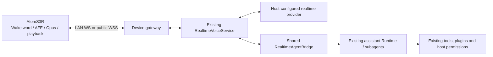

# CardBush embodied voice integration

[简体中文](EMBODIED_INTEGRATION.zh-CN.md)

The first supported device is the **M5Stack AtomS3R AI Chatbot Kit (AtomS3R + Atomic Voice Base)**. This implementation includes compiled firmware and an installer. Software and simulated integration tests are available; **physical USB flashing, microphone/speaker operation, acoustic echo cancellation, and public-network latency have not been verified on hardware**.

## Architecture



The MCU handles wake words, audio processing, encoding, playback and immediate playback cancellation. It does not run the language model or store model-provider credentials. The host reuses the existing realtime service, history, task dispatcher, completion notifications, Runtime and authorization system. The browser and device adapters share the extracted `RealtimeAgentBridge`.

Hardware connects to the existing `personal-assistant` conversation. The assistant keeps talking while child conversations perform tasks. Speech grants no additional privileges; requests requiring host approval still use the existing host interaction flow. One assistant audio connection can be active per host, across desktop and devices. A second connection receives a busy error instead of taking over the first. Ordinary non-assistant calls retain their existing behavior.

The device listener is disabled by default. The installation workflow explicitly configures and enables it.

## Supported deployments

| Route | Behavior |
| --- | --- |
| Device → LAN desktop | Inherits the desktop assistant's persona, model, permissions and selected execution host |
| Device → independent LAN Agent | Uses that instance's settings and Runtime without a desktop UI |
| Device → public cloud Agent | Same protocol over WSS; tasks operate on cloud-side files and tools |
| Device → desktop assistant → configured cloud Agent | Reuses existing assistant remote delegation; the desktop still owns audio |

A device connected directly to a cloud Agent does not grant that Agent access to the user's computer. This change does not implement a reverse cloud-to-PC execution tunnel. Connect to the desktop or configure an explicit execution route when PC access is needed. Devices can initiate outbound connections to cloud WSS without exposing a user's PC port.

## Desktop installation

1. Update, build and restart CardBush. Configure **realtime voice mode** in the existing voice settings. A text-model API key is not automatically a compatible realtime voice connection. Existing `volcengine` and `cardbush.realtime.v1` adapters are reused.
2. Confirm the assistant's model, persona, selected host and permissions. The desktop synchronizes them to the host; no separate model account is configured on hardware. A call pins the configuration at connection time. Reconnect after changing it.
3. Connect the Kit with a USB data cable. Ask the Agent to install and pair it using `embodied-connect`. Identify the exact board, serial port, reachable host address and 2.4 GHz Wi-Fi network. ESP32-S3 chip identity alone does not identify a board.
4. The skill prepares pinned Python USB dependencies, verifies the bundled firmware, backs up all original flash, pairs the device, writes firmware/NVS and checks the connection.
5. Read the actual receipt. `connected` confirms the device and provider handshake, not acoustic quality. `awaiting-connection` means flashing completed but connectivity is unconfirmed; do not automatically flash again.

The same helper can be run from the repository root:

Python 3.10+ is required on the host. The helper installs its USB dependencies into a private cached environment without changing system Python packages. Desktop device calls read the existing host voice selection at connection time; independent services use `assistant.voice`.

```powershell
python assets/skills/embodied-connect/scripts/device.py status
python assets/skills/embodied-connect/scripts/device.py list
python assets/skills/embodied-connect/scripts/device.py configure --url ws://192.168.1.10:4782/api/embodied/v1/audio
python assets/skills/embodied-connect/scripts/device.py install --port COM7 --wifi-file D:/workspace/wifi.local.json --backup-dir D:/workspace/device-backups
```

Replace example addresses and ports. The Wi-Fi file contains:

```json
{"ssid":"YOUR_2.4_GHZ_NETWORK","password":"YOUR_PASSWORD"}
```

Credentials are read from files, never placed in command arguments, chat or source control. Flash backups can also contain old device credentials; retain them in a controlled workspace. If download mode is required, follow M5Stack's reset-button procedure (hold approximately two seconds and confirm download status), then use the same port. The installer never guesses a board or flashes every available port.

The listener normally binds `0.0.0.0:4782`; configure the host firewall for the intended network. Plain WS is limited to private LAN IPs and intended for trusted LANs. Use WSS elsewhere. A device must not be configured with the computer's `127.0.0.1` address.

Revoke or restore explicitly:

```powershell
python assets/skills/embodied-connect/scripts/device.py revoke --device-id aa:bb:cc:dd:ee:ff
python assets/skills/embodied-connect/scripts/device.py restore --port COM7 --backup D:/workspace/device-backups/EXACT_BACKUP.bin
```

Restore checks the companion JSON receipt, MAC, size and SHA-256 before overwriting flash. Revocation does not restore old firmware; restoring firmware does not revoke the host's pairing record.

## Independent / cloud Agent

Reuse the [existing Agent deployment](deploy/agent/README.md), with a separate data directory and service account per instance. Devices are unavailable on text-only (`--disable-tools`) and restricted Web deployments.

```sh
node dist-electron/agentServiceCli.mjs --data-dir /srv/cardbush/agent-a --host 127.0.0.1 --port 4780
```

Management uses the existing authenticated `POST /api/agent/v1/call` endpoint:

```json
{"operation":"devices.command","input":{"action":"status"}}
```

Actions: `status`, `configure`, `pair`, `revoke`, `assistant.get/save`, `voice.get/save`. `voice.save` accepts the existing realtime settings format and keeps provider credentials encrypted on the host. `assistant.save` accepts partial updates:

```json
{"operation":"devices.command","input":{"action":"assistant.save","input":{"modelId":"YOUR_CONFIGURED_MODEL_ID","language":"en","permissionMode":"task_free","profile":{"name":"assistant","persona":"Speak naturally and concisely."}}}}
```

The helper also offers `voice-settings [--file SETTINGS_JSON]` and `assistant-settings [--file SETTINGS_JSON]`: omit the file to read redacted settings, supply it to save. `disable` closes the listener and retains pairings. See the skill's [host setup reference](assets/skills/embodied-connect/references/host-setup.md).

Manage a cloud host from the USB-connected computer:

```powershell
python assets/skills/embodied-connect/scripts/device.py --agent-url https://agent.example.com --token-file D:/workspace/agent-token.local.json configure --url wss://voice.example.com/api/embodied/v1/audio
python assets/skills/embodied-connect/scripts/device.py --agent-url https://agent.example.com --token-file D:/workspace/agent-token.local.json install --port COM7 --wifi-file D:/workspace/wifi.local.json --backup-dir D:/workspace/device-backups
```

`--token-file` contains the **plain text Agent access token**, not a JSON object. The example extension is ignored by the repository's existing credential rules. This administrative credential remains on the computer. Hardware receives a different random token scoped only to the audio gateway.

Use `tlsCert` and `tlsKey` in `configure` for direct TLS, or an existing HTTPS reverse proxy. Example Caddy route:

```caddyfile
voice.example.com {
    @audio path /api/embodied/v1/audio
    reverse_proxy @audio 127.0.0.1:4782
    respond 404
}
```

Preserve `Authorization`, `Device-Id`, `Protocol-Version` and WebSocket upgrade. Use a certificate trusted by the device; do not disable certificate validation. Management and audio endpoints have separate credentials. Never have the proxy inject an administrative token into anonymous requests. Containers also need an explicit port mapping for 4782 or a proxy on their internal network.

Local management uses `DATA_ROOT/embodied/control.json`, a loopback-only endpoint with an independent management token. The installer accepts `--control-file`. Desktop `DATA_ROOT` is Electron userData; an independent Agent uses `--data-dir`. Do not publish the control descriptor.

## Device protocol v1

The wire format is Xiaozhi **WebSocket v1** plus the `cardbush` extension:

```text
GET /api/embodied/v1/audio
Authorization: Bearer DEVICE_TOKEN
Device-Id: DEVICE_ID
Protocol-Version: 1
```

Browser `Origin` requests and invalid identities are rejected. The MAC is the Kit's identifier; the token is the credential. The host persists token hashes and supports revocation. Duplicate connections for an identity are rejected.

Device hello:

```json
{"type":"hello","version":1,"transport":"websocket","features":{"cardbush":true,"mcp":false},"audio_params":{"format":"opus","sample_rate":16000,"channels":1,"frame_duration":20}}
```

| Event / direction | Meaning |
| --- | --- |
| Host `hello` | Assistant/provider ready; mono Opus output at 24 kHz with negotiated frame duration |
| Binary, both directions | One Opus packet per message; 20/40/60 ms supported; converted to existing 16 kHz PCM / 20 ms provider input and 24 kHz provider output |
| Device `listen` | `start` with `realtime/auto/manual`; `stop` commits input |
| Device `abort` | Interrupt speech without cancelling accepted child tasks |
| Device `cardbush/speech` | `speaking:true` reports device AFE voice detection; interrupts active output |
| Host `cardbush/interrupt` | Increasing `epoch`; discard decoder/playback queues |
| Device `cardbush/playback` | Actual speaker status; report false after draining |
| Host `tts` / `stt` | Speech lifecycle and optional text, never a direct tool invocation |
| Host `cardbush/heartbeat` | Application keepalive alongside WebSocket ping/pong |

The host bounds initial readiness at 95 seconds, allowing existing voice-memory restoration. Firmware waits up to 100 seconds; the installer observes for 120 seconds by default. These are failure deadlines, not per-turn latency. Audio streams frame by frame without waiting to save a whole utterance. Output is paced with bounded queues, packet sizes and input rates. Congestion closes the audio connection and retains tasks.

Device MCP announcements do not automatically register tools. Future actuators need explicit capabilities, authorization and action receipts; raw device commands must not become an unrestricted shell interface.

## Firmware and installation transaction

- Upstream: [`78/xiaozhi-esp32`](https://github.com/78/xiaozhi-esp32), commit pinned in `deploy/embodied/firmware.json`, board `m5stack/atoms3r-echo-base`.
- Reuses Kit pin mappings, LCD, I²S, wake words and AFE. Patches prioritize the configured host, skip upstream activation/OTA, report playback, clear interrupted audio and supply software echo reference. Bundled firmware uses 20 ms Opus frames to reduce packetization delay; this is not a 20 ms end-to-end latency claim.
- The original ES8311 driver lacks a reference input. This build supplies a bounded playback reference to the existing ESP-SR AFE and enables device AEC. **Reference alignment, volume effects and residual echo require physical tuning. Successful compilation does not prove natural full-duplex speech.**
- It attempts a connection after boot/network setup. Later wake-ups use the existing “你好小智” wake word. Host and provider must be online. Offline LLM execution, reverse cloud-to-PC access and general OTA management are not implemented.
- Transaction: verify images → verify chip/8 MB flash → back up → pair → generate NVS → flash → observe readiness. Flash failures attempt to revoke the new token, preserve backups and never automatically reflash or restore. Temporary plaintext provisioning files are removed.
- If a pairing HTTP request times out, inspect host state before retrying. An unknown outcome is not proof that pairing did not happen.
- This development firmware does not enable ESP32 Flash encryption or Secure Boot. Physical access can expose the device's Wi-Fi credentials and scoped token. Production provisioning needs a separate design for device identity, credential rotation and secure updates.

Rebuild firmware with Docker, without accessing USB:

```sh
python deploy/embodied/build_firmware.py
```

The SDK image is pinned by digest, uses the dedicated `cardbush-embodied-build` volume, and restores versions from the packaged `dependencies.lock`. Output under `assets/skills/embodied-connect/assets/firmware/atoms3r-ai-chatbot/` includes flash images, SHA-256 manifest and upstream/third-party licenses. Installation needs neither Docker nor a compiler.

## Validation and next hardware work

```sh
npm run test:embodied
python -m venv .venv-embodied
# Use the Python executable in that environment:
python -m pip install esptool==5.5.0 esp-idf-nvs-partition-gen==0.3.0 pyserial==3.5
python scripts/test-embodied-installer.py
```

Tests exercise pairing/revocation, credential separation, Opus conversion, real WebSocket transport, duplicate connections, barge-in and stale-audio suppression, an independent Agent's real Runtime child task and spoken completion, reconnection without task replay, real NVS generation, and simulated USB backup/failure transactions. Providers and USB are fixtures; tests do not use paid models or physical serial ports.

Hardware acceptance:

1. Back up and install once; confirm boot-time connection and `status.connected`.
2. Test short/long utterances, pauses, near/far speech, Chinese and English; check for clipping, lost speech and echo.
3. Interrupt playback; confirm prompt silence, no feedback loop and no interpretation of the assistant's speaker output as user commands.
4. Dispatch one explicit small task; confirm an existing child conversation, one execution, continued conversation and completion feedback.
5. Disconnect Wi-Fi, restart the host and revoke pairing. Verify that task records survive and reconnecting does not execute the original request again.
6. Measure end-of-utterance-to-first-audio and barge-in-to-silence separately on LAN and cloud; retain P50/P95. `handshakeMs`, first-frame timestamps, frame counters and interruption counts help locate transport problems but are not acoustic latency measurements.

New hardware should reuse the protocol and host path, adding reviewed board firmware, a USB profile and audio adaptation. New rates, capability negotiation and actuator actions should evolve through explicit protocol versions. Sharing the ESP32-S3 chip does not make another board compatible with this firmware.

## Code map

| Path | Responsibility |
| --- | --- |
| `electron/embodiedHost.mts` | Shared desktop/headless device host and protected management |
| `electron/embodiedGateway.mts`, `embodiedAudio.mts` | Negotiation, transport, codec conversion, queues and interruption |
| `electron/embodiedDevices.mts` | Durable pairing, token hashes and revocation |
| `electron/assistantVoiceHost.mts` | Host assistant settings and existing Runtime adaptation |
| `packages/bush-runtime/src/realtimeConversationBridge.ts` | Shared dispatch, observation and notification bridge |
| `assets/skills/embodied-connect/` | Installation skill, Python helper and compiled firmware |
| `deploy/embodied/` | Pinned build inputs and upstream patches |

References: [M5Stack Kit](https://docs.m5stack.com/en/core/AtomS3R-AI_Chatbot), [upstream WebSocket protocol](https://github.com/78/xiaozhi-esp32/blob/main/docs/websocket.md), [ESP-SR AEC](https://docs.espressif.com/projects/esp-sr/en/latest/esp32s3/acoustic_echo_cancellation/README.html).
