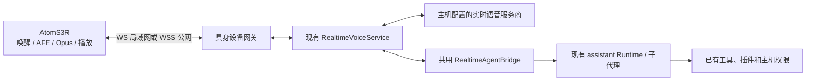

# CardBush 具身语音接入

[English](EMBODIED_INTEGRATION.en.md) · [简体中文](EMBODIED_INTEGRATION.zh-CN.md)

首款适配 **M5Stack AtomS3R AI Chatbot Kit（AtomS3R + Atomic Voice Base）**。这是可构建、可安装的首版接入；已完成软件与模拟互联验证，**尚未进行真实 USB 烧录、麦克风、扬声器、声学回声消除和公网延迟验收**。

## 分工与复用



- 设备是 assistant 的语音终端，不在 ESP32 上运行大模型或保存模型服务商密钥。设备端负责唤醒、收音、音频处理、压缩、播放和即时清空播报队列。
- 主机沿用现有实时语音服务、会话记忆、任务派发、完成通知、Runtime 和工具权限。浏览器端与设备端共用从原组件提取的 `RealtimeAgentBridge`。
- 使用同一个 `personal-assistant` 会话，任务进入子会话；语音保持交互，耗时工作后台执行。语音不赋予额外操作权限。需要主机批准的操作仍通过现有主机交互处理。
- 桌面和独立 Agent 各自最多有一个活跃的 assistant 音频连接。第二端会得到忙碌错误，不抢占已有通话。普通非 assistant 语音会话不受这个互斥限制。
- 设备监听默认关闭。安装 skill 负责显式配置和启用，不在安装应用时自动开放网络服务。

## 已支持的拓扑

| 连接 | 运行位置与行为 |
| --- | --- |
| 设备 → 局域网 CardBush 桌面 | 使用桌面 assistant 的人格、模型、权限和子代理设置；任务在当前选定主机执行 |
| 设备 → 局域网独立 Agent | 使用该实例自己的配置和 Runtime；无需打开桌面应用 |
| 设备 → 公网云 Agent | 同一协议通过 WSS 连接独立 Agent，任务操作云端文件和工具 |
| 设备 → 桌面 assistant → 已配置云 Agent | 复用 assistant 原有的远程子代理路由，音频仍由这台桌面主机承接 |

云 Agent 直接接入设备**不等于**获得用户电脑的访问权。独立服务目前不新增“云端反向控制电脑”通道；要操作电脑应连接桌面主机，或另行配置明确的主机执行通道。公网不要求开放用户电脑的入站端口，设备可以主动连接云端 WSS。

## 桌面端安装

1. 更新、构建并重启 CardBush。在“语音”中配置已有的**实时语音模式**；文本模型的 API Key 不能自动当成实时语音接口使用。现有 `volcengine` 和 `cardbush.realtime.v1` 服务适配继续使用。
2. 确认 assistant 的模型、执行主机、权限和人格。桌面会把这部分设置同步到主机，硬件通话不需要另一套模型配置。已有通话使用建立连接时的配置快照，配置变更后重新连接。
3. 连接 Kit 的 USB 数据线，在 CardBush 中要求“使用 embodied-connect 安装并配对我的 AtomS3R AI Chatbot Kit”。明确端口、局域网主机地址和 2.4 GHz Wi‑Fi。只按 ESP32-S3 芯片型号不能识别完整板型。
4. 安装 skill 使用随包固件，自动准备固定版本的 USB Python 依赖；先备份整片原固件，再配对、烧录、等待设备与语音服务握手。
5. 查看回执。`connected` 表示设备及主机语音握手成功，不能代替实际听说测试。`awaiting-connection` 表示烧录完成但连接尚未确认，**不要直接重复烧录**。

手动执行同一个辅助脚本（在仓库根目录）：

主机需要 Python 3.10+；USB 专用依赖由脚本自动放入独立缓存环境，不修改系统 Python 包。桌面端每次设备接通时读取现有语音设置中的音色选择；独立服务使用 `assistant.voice`。

```powershell
python assets/skills/embodied-connect/scripts/device.py status
python assets/skills/embodied-connect/scripts/device.py list
python assets/skills/embodied-connect/scripts/device.py configure --url ws://192.168.1.10:4782/api/embodied/v1/audio
python assets/skills/embodied-connect/scripts/device.py install --port COM7 --wifi-file D:/workspace/wifi.local.json --backup-dir D:/workspace/device-backups
```

地址和 `COM7` 都是示例，请使用真实值。Wi‑Fi 文件格式：

```json
{"ssid":"YOUR_2.4_GHZ_NETWORK","password":"YOUR_PASSWORD"}
```

凭据通过本地文件读取，不放在命令行参数、聊天或 Git 中。完整固件备份也可能包含原设备凭据，保存在自己控制的工作区中。需要进入下载模式时，按 M5Stack 官方说明长按复位键约两秒，确认下载状态后再使用同一个端口；安装器不会猜测板型或遍历所有串口烧录。

监听地址通常为 `0.0.0.0:4782`，应按使用环境配置主机防火墙。WS 仅允许私有局域网 IP；LAN 明文连接适合可信网络，其他网络使用 WSS。设备连接地址不能使用电脑的 `127.0.0.1`。

撤销与恢复：

```powershell
python assets/skills/embodied-connect/scripts/device.py revoke --device-id aa:bb:cc:dd:ee:ff
python assets/skills/embodied-connect/scripts/device.py restore --port COM7 --backup D:/workspace/device-backups/EXACT_BACKUP.bin
```

恢复会校验配套 JSON 回执、MAC、大小与 SHA-256，然后覆盖闪存。撤销令牌不会自动刷回旧固件；恢复旧固件也不会自动撤销主机配对记录。

## 独立 Agent / 云端

复用现有 [Agent 部署说明](deploy/agent/README.md)，不需要新建另一套 Agent 服务。每个实例使用独立目录和服务账号。关闭工具或启用受限 Web 部署的实例不开放设备接入能力。

```sh
node dist-electron/agentServiceCli.mjs --data-dir /srv/cardbush/agent-a --host 127.0.0.1 --port 4780
```

通过现有鉴权接口 `POST /api/agent/v1/call` 的 `devices.command` 操作管理设备。HTTP 请求体为：

```json
{"operation":"devices.command","input":{"action":"status"}}
```

`action` 包括 `status`、`configure`、`pair`、`revoke`、`assistant.get/save`、`voice.get/save`。`voice.save` 使用已有实时语音设置格式；服务商密钥只写入主机加密配置。`assistant.save` 支持部分更新，例如：

```json
{"operation":"devices.command","input":{"action":"assistant.save","input":{"modelId":"YOUR_CONFIGURED_MODEL_ID","language":"zh","permissionMode":"task_free","profile":{"name":"assistant","persona":"自然、简洁地交流。"}}}}
```

辅助脚本也提供 `voice-settings [--file SETTINGS_JSON]`、`assistant-settings [--file SETTINGS_JSON]`，不传文件时读取脱敏设置，传文件时保存。`disable` 关闭监听并保留配对。详见 [安装 skill 的主机配置说明](assets/skills/embodied-connect/references/host-setup.md)。

从接着 USB 的电脑管理云 Agent：

```powershell
python assets/skills/embodied-connect/scripts/device.py --agent-url https://agent.example.com --token-file D:/workspace/agent-token.local.json configure --url wss://voice.example.com/api/embodied/v1/audio
python assets/skills/embodied-connect/scripts/device.py --agent-url https://agent.example.com --token-file D:/workspace/agent-token.local.json install --port COM7 --wifi-file D:/workspace/wifi.local.json --backup-dir D:/workspace/device-backups
```

`--token-file` 的内容是**纯文本 Agent 访问令牌**，不是 JSON 对象；示例扩展名只是方便本仓库默认忽略。管理凭据只留在电脑，设备拿到的是仅能连接音频网关的随机设备令牌。

可选方式：在 `configure` 中指定 `tlsCert` / `tlsKey` 让网关直接终止 TLS；或复用 HTTPS 反向代理。Caddy 路由示例：

```caddyfile
voice.example.com {
    @audio path /api/embodied/v1/audio
    reverse_proxy @audio 127.0.0.1:4782
    respond 404
}
```

反向代理需要保留 `Authorization`、`Device-Id`、`Protocol-Version`，支持 WebSocket upgrade。证书应被设备信任；不关闭证书校验。Agent 管理接口与音频接口使用各自的鉴权，不能通过代理向匿名请求注入管理令牌。使用容器时还需要显式映射 4782，或让反向代理在同一容器网络访问它。

主机本地管理描述符位于 `DATA_ROOT/embodied/control.json`，仅绑定回环地址，持有独立管理令牌。安装器可通过 `--control-file` 选择该文件。桌面默认 `DATA_ROOT` 为应用 userData；独立 Agent 为 `--data-dir`。临时描述符不上传、不提交。

## 设备协议 v1

基于 Xiaozhi **WebSocket v1**，加 `cardbush` 扩展。设备连接：

```text
GET /api/embodied/v1/audio
Authorization: Bearer DEVICE_TOKEN
Device-Id: DEVICE_ID
Protocol-Version: 1
```

浏览器 `Origin` 请求和错误身份被拒绝。MAC 是本款的设备标识，**令牌才是鉴权凭据**。令牌在主机只保存哈希，可撤销；同一设备不能建立两个并行连接。

设备发送：

```json
{"type":"hello","version":1,"transport":"websocket","features":{"cardbush":true,"mcp":false},"audio_params":{"format":"opus","sample_rate":16000,"channels":1,"frame_duration":20}}
```

| 方向 / 事件 | 含义 |
| --- | --- |
| 主机 `hello` | assistant 与语音服务准备就绪；返回单声道 Opus、24 kHz、协商帧时长 |
| 双向二进制帧 | 一条消息一个 Opus 包，支持 20 / 40 / 60 ms；网关转成现有服务的 16 kHz PCM 20 ms 输入和 24 kHz 输出 |
| 设备 `listen` | `start` 带 `realtime/auto/manual`；`stop` 提交输入 |
| 设备 `abort` | 中断正在播报的回复，不取消已受理的子代理任务 |
| 设备 `cardbush/speech` | `speaking:true` 表示经过设备 AFE 的说话检测，播报中触发插话 |
| 主机 `cardbush/interrupt` | `epoch` 递增，清空设备解码 / 播放队列 |
| 设备 `cardbush/playback` | `speaking` 报告实际播放状态，排空后回报 false |
| 主机 `tts` / `stt` | 开始 / 停止播报、可选文字，不是工具调用入口 |
| 主机 `cardbush/heartbeat` | 保活，配合 WebSocket ping/pong |

握手最长等待 95 秒，主要给既有语音记忆恢复留出空间；这不是每轮固定延迟。固件等待上限 100 秒，安装器默认观察 120 秒。正常音频逐帧转发，不等待整句落盘。下行按帧时长发送，队列、包大小和速率都有上限，超限结束连接并保留原任务。

设备声明的 MCP 工具**不会自动注册到主机**。后续机械动作需要另行定义设备能力、授权与执行回执，不能把原始硬件指令直接开放为普通终端命令。

## 固件与安装事务

- 上游：[`78/xiaozhi-esp32`](https://github.com/78/xiaozhi-esp32)，固定提交见 `deploy/embodied/firmware.json`，板型 `m5stack/atoms3r-echo-base`。
- 使用上游 Kit 引脚、LCD、I²S、唤醒和 AFE，增加自定义服务地址优先、跳过上游激活/OTA、播放状态回报、插话清队列和软件回声参考。随包固件使用 20 ms Opus 帧，减少分帧等待；这不代表整体响应延迟只有 20 ms。
- ATOMS3R 的 ES8311 驱动原来没有回声参考输入。本版向已有 ESP-SR AFE 提供有限长度的播放参考，并启用设备 AEC。**声学对齐、播放音量影响和残余回声必须真机调试；软件编译无法证明全双工效果。**
- 开机联网后自动尝试接通；后续可用原有“你好小智”唤醒。设备仍依赖主机与服务商在线，未实现离线大模型、云端反向连接 PC 或通用 OTA 管理。
- 安装顺序：校验固件 → 确认芯片 / 8 MB 闪存 → 备份 → 配对 → 生成 NVS → 写入 → 观察连接。写入失败会尝试撤销新令牌，保留备份，不自动重刷 / 恢复。临时明文配置用后清理。
- 若配对 HTTP 请求超时，先检查主机状态；不能把未知结果当成未执行而反复创建凭据。
- 此版不启用 ESP32 Flash 加密或 Secure Boot；设备上的 Wi‑Fi 和设备令牌可被有物理访问权限的人读取。后续量产需要独立设计设备身份、密钥轮换和安全升级，不应照搬开发安装策略。

重建随包固件（Docker；不访问 USB）：

```sh
python deploy/embodied/build_firmware.py
```

SDK 镜像由 digest 固定，使用独立构建卷 `cardbush-embodied-build`，依赖版本从随包 `dependencies.lock` 恢复。输出位于 `assets/skills/embodied-connect/assets/firmware/atoms3r-ai-chatbot/`，包含分区映像、SHA-256 清单和上游 / 第三方许可。安装时不需要 Docker 或重新编译。

## 验证与继续开发

软件检查命令：

```sh
npm run test:embodied
python -m venv .venv-embodied
# 使用该虚拟环境的 Python 安装测试依赖：
python -m pip install esptool==5.5.0 esp-idf-nvs-partition-gen==0.3.0 pyserial==3.5
python scripts/test-embodied-installer.py
```

测试覆盖：配对 / 撤销 / 凭据边界、Opus 编解码、真实 WebSocket 网关、重复连接、插话丢弃旧音频、独立 Agent 的真实 Runtime 子任务与通知、重连不重复派发、真实 NVS 生成，以及模拟 USB 事务的备份和失败处理。测试服务商和 USB 为 fixture，未调用付费模型或真实串口。

真机按下面顺序验收，并保留日志：

1. USB 完整备份和一次安装；确认重启后自动连接，`status.connected` 为 true。
2. 短句、多轮长句、停顿、远近说话、中文及英文；确认无丢字、削波和明显回声。
3. 播报时插话，确认立刻停播、不自激、不把 assistant 自己的声音当成用户指令。
4. 下达一个明确的小任务；确认进入已有子会话、只执行一次、语音能继续交流、完成后回报。
5. 暂时断开 Wi‑Fi、重启主机、撤销设备；确认原任务记录保留，重新接通不重做原任务。
6. 分别测 LAN 和云端的“说完到首段声音”“插话到静音”，记录 P50 / P95。状态中的 `handshakeMs`、首帧时间、帧计数和中断次数用于定位链路；它们不是声学延迟实测值。

新硬件优先复用这个协议和主机链路，只新增板型固件 / USB 配置档 / 音频适配；不同采样率、能力协商或新设备动作通过明确的协议版本演进。不要因另一块板也使用 ESP32-S3 就套用本固件。

## 代码入口

| 位置 | 职责 |
| --- | --- |
| `electron/embodiedHost.mts` | 桌面与独立 Agent 的统一设备宿主、受保护管理入口 |
| `electron/embodiedGateway.mts` / `embodiedAudio.mts` | 握手、连接、Opus/PCM、队列和打断 |
| `electron/embodiedDevices.mts` | 配对持久化、令牌哈希、撤销 |
| `electron/assistantVoiceHost.mts` | assistant 主机设置、现有 Runtime 执行适配 |
| `packages/bush-runtime/src/realtimeConversationBridge.ts` | 桌面与硬件共用的派发、观察和完成通知 |
| `assets/skills/embodied-connect/` | 安装 skill、Python 安装器、已编译固件 |
| `deploy/embodied/` | 固定版本构建配置和最小上游补丁 |

硬件参考：[M5Stack Kit](https://docs.m5stack.com/en/core/AtomS3R-AI_Chatbot)、[上游 WebSocket 协议](https://github.com/78/xiaozhi-esp32/blob/main/docs/websocket.md)、[ESP-SR AEC](https://docs.espressif.com/projects/esp-sr/en/latest/esp32s3/acoustic_echo_cancellation/README.html)。
