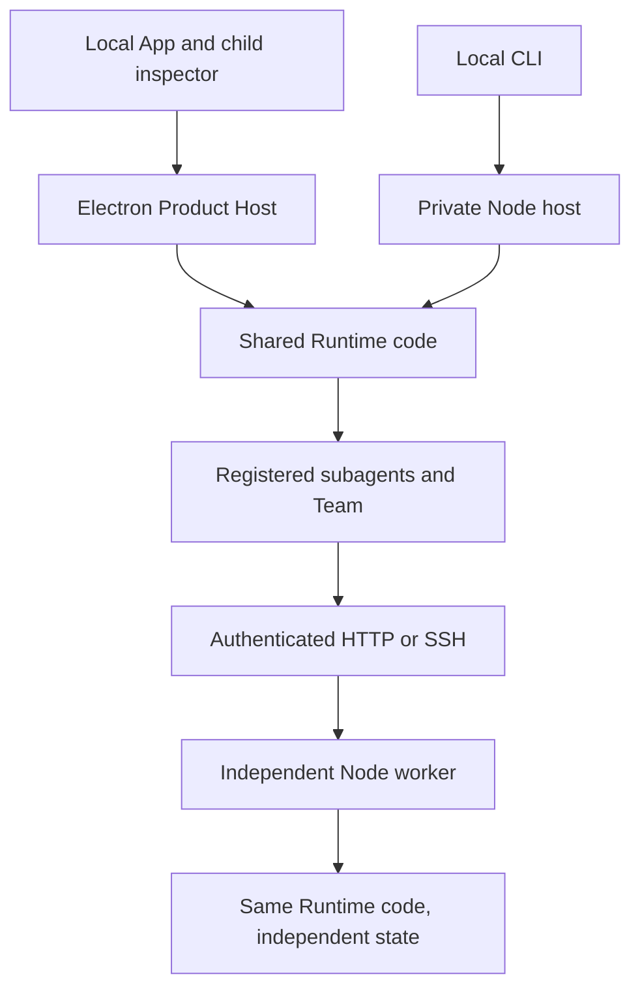

# Current architecture

[English](ARCHITECTURE.en.md) · [简体中文](ARCHITECTURE.md)

This describes current source; installed packages can lag. Historical investigations do not replace these boundaries. See [service deployment](AGENT_SERVICES.en.md) and [release maintenance](CROSS_PLATFORM_RELEASE.md).

## Execution hosts

| Mode | Loop/model | Files/commands | Lifetime |
| --- | --- | --- | --- |
| Desktop conversation | Desktop-owned Runtime | Local workspace or explicitly authorized tool environment | App lifetime. |
| Local CLI | Private local Runtime shared by CLI windows | Current/bound workspace | Independent from App; separate sessions. |
| SSH project | Loop remains local | Selected SSH/SFTP directory; `environment:local` still means local | Local host owns connection; lost commands are not replayed. |
| Independent worker | Its own Runtime/model/credentials | Worker host/tools | Node service owns accepted jobs after client disconnect. |

SSH projects need no remote CardBush service. SSH worker connections instead carry HTTP/events over SSH channels to a remote loopback service, without a local listening forward. They may share an SSH record, not task/configuration ownership. Standalone Agents chats and CLI remote-chat selection have been removed; remote services are registered workers used through subagents/Team.

## Shared core and adapters

| Module | Responsibility |
| --- | --- |
| `bush-protocol` | Typed/validated commands, events, sessions, tool and interaction contracts. |
| `bush-runtime` | Loop, turns, history, permissions, context maintenance and native tools. |
| `bush-product-agent` | Product instructions, time snapshots, model parameters and turn construction. |
| `cardbush-product-host` | Model/plugin/MCP/sandbox/maintenance commands and configuration; injected host capabilities. |
| `bush-provider-openai` | Responses, Chat Completions and Anthropic Messages projections, streams, replay and provider differences. |
| `bush-mcp-client` | MCP lifecycle and tool/resource calls. |
| `bush-runtime-electron` | Typed Runtime clients/transports, also reused by Node despite its name. |
| `cardbush-platform` | System capability, shell and native program resolution; browser-safe and Node exports separated. |
| `runtimeHostController.mts` / `runtimeHostWorker.mts` | Desktop lifecycle and shared worker entry. |
| `agentServiceCli.mts` / `agentService.mts` / `agentRuntimeHost.mts` | Node entry, durable HTTP queue and Worker host, without launching Electron. |
| `productHostController.mts` | Shared product commands bound to host settings/plugins/maintenance. |
| `assistantConversation.ts` / `conversationJournal.ts` | Continuous assistant conversation, separate journal and delegated completion feedback. |
| `realtimeVoiceService.ts` / `src/features/voice` | Realtime provider, application call ownership, audio/context bridge. |
| `src` | React presentation, authoritative event consumption, page history and host adapters. |

A file under `electron/` does not imply an Electron runtime dependency. Conversely, the complete desktop installer is not the server distribution.

## Windows and loading boundaries

`src/main.tsx` chooses the window role before loading main workspace, companion or shadow conversation, with retry on load failure. Windows share presentation components, not ownership of workspace hooks. Preload retains the latest companion state so lazy subscribers receive initial state.

Office/3D previews use separate HTML entries. Vite splits by actual ownership, not shared preload helpers. Protocol defaults to ESM; voice's CommonJS entry is generated from the same source, avoiding duplicate validation libraries and divergent tool schemas. Execution inspection lazily chooses read-only history or a continuing child; opening history does not initialize the child adapter. Scene/desktop panels load on demand and retry locally.

`modelPreviewMain.ts` handles reads/cancellation/progress/errors; validated Blender scenes then load `sceneView.ts` for glTF/WebGL. Retry/close cancels conversion and disposes graphics. Three core/WebGL and spreadsheet codecs remain behind their actual use boundaries and cache independently. Do not arbitrarily split chunks or raise the warning threshold.

`test:renderer-boundaries` inspects production dependency closure: previews do not load chat, companion does not load workspace, shadow avoids useCardbushChat, browser avoids duplicate CommonJS Zod, and loading/error UI avoids early Three. It also checks the existing 500 kB chunk bound. Bundle size is not runtime memory. Native dialog cancel/close goes through `dialogEventHandler`; child/file-dialog events cannot close a parent.

## Conversation facts and settings

Local chat shares useCardbushChat, ChatPanel, composer and Runtime event semantics. Remote child inspectors retain the original host context through `conversationHost.ts`; remote paths are not local file paths. Services persist inputs before acknowledging and clearing only the matching draft. Same-session execution is sequential; other sessions remain independent. Retried submissions retain identity/content. Stream reconnect is separate from send; unsubscribe never means stop.

Tool start/return/failure comes from Runtime events; display titles, history summaries and archive locators are not new execution. Navigation stores location, not secrets/drafts/results; background streams do not add history. In-page Back resolves its route parent even if browser history was evicted; window forward/back remains chronological.

Settings manages the current Product Host. Worker configuration is independent, with no automatic connection sync. Theme/language/fonts/shortcuts are UI preferences. Gate new fields on declared capabilities. Model connections have explicit apiProtocol/custom headers and immutable provider-binding revisions. Inject conversation headers per request, never mutate a shared concurrent binding.

ModelProviderRegistry selects adapters only. Adapters project messages and normalize streams; they neither execute tools nor own history or next-round decisions. `executeModelRound` collects normalized events, and Runtime owns tools, permissions, retry, stop, compression and recovery. Signed provider reasoning stays opaque replay data, not a second loop state.

## Assistant and voice

The fixed personal-assistant journal records page content, internal transcripts, receipts and summaries separately from ordinary SessionStore/Turn logs. Message-ID idempotency and reset generations reject late writes. UI uses explicit source/visibility, not text heuristics. Assistant text uses the shared model round with conversation/delegation tools and page_write; actual execution uses existing child dispatch/permissions/persistence. Realtime follows the same ownership principles without directly executing filesystem/terminal tools in the conversational parent.

Assistant model/effort belongs to personal-assistant, not the current ordinary composer. Fork children inherit the current parent model/binding/effort/budgets on initial and completed-task continuation while retaining child identity/history/instructions/limits. Active guidance does not change an in-flight model; explicit clean configuration remains separate. Voice uses its own model connection.

Assistant no longer selects a direct remote host. It assembles registered workers/Team locally; continuations retain role/service/task ownership. File transfer is explicit and no parent history/OAuth/model credentials are copied. `applicationVoiceSession` owns microphone, playback and execution bridge across navigation/settings/minimize. Controls follow the owning composer/capsule; draft dictation remains bound to the visible page and cancels unsubmitted capture on leaving. Hangup and task cancellation are separate.

Realtime provider normalizes audio/context/receipts/control; the service deduplicates, applies backpressure and recovers. Voice context maintenance uses an independent text-model compression transaction and confirms new remote history before replacement; uncertain recovery rebuilds the connection without replaying tools. Secure storage encrypts voice-history transcripts/summaries; session JSONL is separate and raw call audio is not archived. Voice context summaries are not cross-session habits. See [Assistant](PERSONAL_ASSISTANT.en.md), [realtime voice](REALTIME_VOICE.en.md), [local voice](LOCAL_VOICE_MODELS.en.md).

## Plugins, references and presentation

Each host owns plugin installation/configuration/enablement/updates. Worker connection copies neither plugins nor configuration; dependencies/accounts belong to the target. Remote hosts cannot open a local OAuth dialog or load desktop-native renderers. App Center lists built-in pages, user apps/URLs and explicit `cardbush.applications`, not every `.app.json` MCP connection. `@` app references supply identity/entry context, not tool installation, permission or proof of execution. MCP result Apps open through real result references, not unsolicited loop popups.

MarkdownReference separates identity from resource address. Source is always a source annotation, even in image syntax; File Memo resolves its record; Apps and @ retain distinct entries. Never infer media type from a reference ID. Short source numbers bind only to current-turn successful creation or explicit read_source_memos records, scoped by host/turn. Unknown numbers remain literal; code/escaped text/links/user messages are not rewritten. Lookup reads saved records, not model/evidence files. Final file and full Source link correction shares one allowance: validate real identity/files and append corrections, never alter prefixes or repeat completed work.

Tool invocation lifecycle differs from process exit: returned can contain a failed/stopped process. Project long output within the common budget, preserving exit status and stderr/error tail before stdout excerpts; retain raw archives for explicit reads. Background notifications reuse that projection without automatic command reruns.

LocalPaths classifies local, SSH, network and inline resources. Resolve relative files against a known workspace; unknown schemes fail explicitly. Electron validates absolute resource paths and never joins reference IDs/web URLs/preview routes to process cwd. Errors neither rewrite history nor invoke model retry. Tool artifacts populate records/turn menus, not automatic media cards beneath execution. Explicit body links/media remain in place.

Images use bounded half-width previews; adjacent image-only paragraphs form stable galleries after Markdown parsing, without rewriting content. Reuse resolved sources, including shared remote reads. Thumbnail selection preserves transcript position. Resize preserves either bottom-follow or a historical text/image anchor; panel/layout movement is not user scrolling.

## Context, memory and remote interaction

Loop compression uses tool names, reasons, actual results and final response to produce a validated handoff, retaining necessary failures/unfinished state. It does not demand an extra summary after each loop; model compression is fallback. See [context and memory](CONTEXT_AND_MEMORY.md).

Final display, optional memory writes and organization are separate. Completion schedules local maintenance only; recall does not harvest future user messages as evidence. Predictions default to seven-day expiry; unexpired permanent habits do not age out. Memory/evidence have separate 8,000-active-record limits; token thresholds are not capacity. Explicit model maintenance uses Runtime internal tasks with unchanged model effort/output, complete-record batches, bounded concurrency, transactional commit and recovery. See [memory maintenance](memory-maintenance.en.md), with historical report scope retained.

[subagent-remote-proton](SUBAGENT_REMOTE_PROTOCOL.md) maps existing role/Team/task, queue/insert, questions, permissions and wakes into a generic interaction channel. Its experimental CardBush HTTP binding is not A2A. Worker policy intersects the parent request; lost observation is not stopped work. Scoped parent credentials, human attestation and independent A2A interoperability remain release gates.

## Isolation, data and updates

Approval/full-access controls are distinct from host sandbox settings. Auto sandbox uses available isolation in approval mode and ordinary processes in full access; required policy cannot be disabled by a child or session. Windows uses AppContainer, Linux bubblewrap. Linux detection uses trusted executables/package managers and actual probes, not a distro-name allowlist. Installation requires an explicit user action. Linux currently lacks additional seccomp and Windows Job Objects-equivalent CPU/memory controls. SSH commands do not acquire OS isolation from desktop settings. See [permissions](PERMISSIONS.md), [sandbox](EXECUTION_SANDBOX.en.md) and [process resources](PROCESS_RESOURCE_PROTECTION.md).

Desktop data lives under Electron userData; services use their data-dir. One process owns each service directory. Owner tokens are administrative, not tenant credentials. Desktop updates do not update workers. Preserve identity/token/config/sessions/plugins/marketplaces/skills and restart safely; queued jobs recover, uncertain active effects do not replay. Bundled skills update separately from user skills. Shared changes require both-host tests; platform-specific changes require relevant platform checks. Update versions, both READMEs, current guides and release notes; preserve historical release facts.
