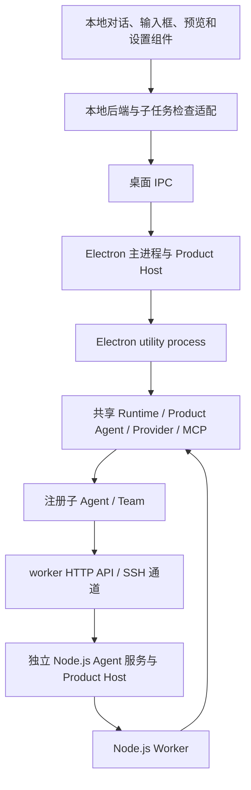

# 当前架构

[English](ARCHITECTURE.en.md) · [简体中文](ARCHITECTURE.md)

本页描述当前源码，安装包可能尚未包含全部更新。历史迁移记录和分析报告不代替这里的运行边界；部署步骤见 [Agent 服务](AGENT_SERVICES.md)，发布步骤见[跨平台发布](CROSS_PLATFORM_RELEASE.zh-CN.md)。

## 执行方式

| 方式 | Agent 循环与模型请求 | 文件／命令执行位置 | 生命周期 |
| --- | --- | --- | --- |
| 本地会话 | 桌面托管的 Runtime | 本机工作区，或工具显式选择的已授权环境 | 随桌面应用运行 |
| 本机 CLI | 本机私有 Runtime，多窗口共享宿主 | 当前目录或已绑定工作区 | 独立于桌面 App，会话数据不合并 |
| SSH 项目 | 仍由桌面 Runtime 执行 | 通过 SSH/SFTP 访问所选远端目录；`environment: local` 仍指本机 | 桌面拥有连接和已知终端；断线不自动重放命令 |
| 独立 Agent 服务 | 服务器自己的 Runtime、模型配置和凭据 | Agent 主机及其可用工具环境 | 独立 Node.js 服务；桌面断开不停止已接收任务 |

SSH 项目无需远端 CardBush 服务。通过 SSH 接入独立 Agent 则是将 HTTP 请求和事件流交给 SSH 通道，连接远端回环地址的 Agent 服务；桌面不再建立本地监听转发端口。这两种方式可以共用保存的 SSH 连接，但不共用任务或配置所有权。

## 共享核心与宿主

图中的共享核心表示使用同一套代码，每个宿主仍拥有独立的运行时状态。

| 模块 | 职责与边界 |
| --- | --- |
| `packages/bush-protocol` | 命令、事件、会话和工具类型及校验；宿主与界面共享协议 |
| `packages/bush-runtime` | Agent 循环、回合状态、执行历史、权限、上下文维护和内置工具 |
| `packages/bush-product-agent` | 产品指令、用户时间快照、模型参数与回合请求构造；本地和远端共用 |
| `packages/cardbush-product-host` | 模型、插件、MCP、沙盒、维护等产品命令及配置存储；具体能力由宿主注入 |
| `packages/bush-provider-openai` | 按模型配置选择 Responses、Chat Completions 或 Anthropic Messages；请求投影、流式归一化、工具回放与供应商差异处理 |
| `packages/bush-mcp-client` | MCP 连接及工具／资源调用 |
| `packages/bush-runtime-electron` | 类型化 Runtime 客户端与传输适配；名称包含 Electron，但 Node Agent 也复用其协议实现 |
| `packages/cardbush-platform` | 系统能力、Shell 与原生程序解析；浏览器安全类型和 Node 实现分别导出 |
| `electron/runtimeHostController.mts`、`electron/runtimeHostWorker.mts` | 桌面 Runtime 生命周期与共享 worker 入口 |
| `electron/agentServiceCli.mts`、`electron/agentService.mts`、`electron/agentRuntimeHost.mts` | 独立服务入口、HTTP/队列管理和 Node Worker 宿主；运行时不启动 Electron |
| `electron/productHostController.mts` | 将共享产品命令接到当前宿主的设置、插件与维护实现 |
| `packages/bush-runtime/src/assistantConversation.ts`、`conversationJournal.ts` | 个人助手的持续交流、独立日志、受限工具及后台完成反馈 |
| `electron/realtimeVoiceService.ts`、`src/features/voice` | 实时 Provider 接入、应用级通话归属、音频和上下文衔接 |
| `src` | React 界面、会话状态消费、页面历史及本地／远端后端适配 |

不要因服务文件位于 `electron/` 就推断服务依赖桌面进程；以入口的实际依赖和宿主实现为准。反过来，也不能将完整桌面安装包当作 Agent 服务器发行物。

## 窗口与加载边界

`src/main.tsx` 先确定窗口角色，再加载主工作区、桌面伴随窗口或影子会话；加载失败保留重试入口。窗口共享展示组件，不共享主工作区 Hook 的状态所有权。伴随窗口的最新状态由 preload 保留一份，延迟加载后订阅仍能收到首次状态。

Office 与 3D 预览使用独立 HTML 入口。Vite 的命名分组按实际入口依赖拆分，不能因为共用预加载辅助函数就让预览加载会话代码。协议包默认提供 ESM；语音主进程所需的 CommonJS 子入口从同一份源码生成，避免浏览器同时加载两套校验库，或文字与语音的工具参数发生偏差。

执行详情入口只负责选择面板：只读回合历史与可继续交流的子代理会话各自延迟加载，查看历史不初始化子代理适配器。交互场景和远端桌面也在打开时加载；加载失败可在对应面板重试，不重载会话。共享输入框、消息列表及会话状态仍复用同一份实现。

`modelPreviewMain.ts` 负责读取、取消转换和显示进度／错误；取得并校验 Blender 场景后才加载 `features/modelPreview/sceneView.ts`。后者拥有 glTF 解析、WebGL 视图与释放逻辑，关闭／重试仍会取消转换并释放图形资源。Three.js 核心与 WebGL 渲染器、表格编解码库按库职责独立缓存，保持在实际预览的加载边界之后；不按任意字节大小切碎模块，也不提高告警阈值。

`npm run test:renderer-boundaries` 检查生产构建的静态依赖闭包，而非只检查文件名：预览不加载会话，伴随窗口不加载主工作区，影子窗口不加载 `useCardbushChat`，浏览器不重复加载 CommonJS Zod。主工作区不能提前加载执行详情、交互场景或远端桌面的实现；3D 加载／错误界面不能提前加载 Three.js。该检查也限制单个代码块不超过现有的 500 kB 告警线，并进入发布测试。构建大小不代表运行内存；第三方引擎拆分后总功能及其所需代码仍保留。

原生 `<dialog>` 的 `cancel` / `close` 统一经 `dialogEventHandler` 判断事件归属；文件选择器取消和子弹窗事件不能关闭父弹窗。新增弹窗同样受契约检查和嵌套弹窗的 Electron 回归测试约束。

## 对话、设置和事实来源

本地对话复用 `useCardbushChat`、`ChatPanel` 和 Runtime 事件消费规则。独立 Agents 聊天入口已取消，远程服务通过注册子 Agent / Team 派发；子任务检查保留必要的宿主适配。`conversationHost.ts` 的文件、附件和工具详情接口依据原任务所属宿主读取，不把远端路径当成本地路径。

- 服务先持久化收到的消息，再确认接收并交给队列执行。输入框按接收结果清理对应草稿；后来的草稿不应被前一轮完成事件清掉。
- 同一会话顺序执行，不同会话独立运行。发送请求 ID 用于去重；网络重试保留 ID 与内容，不能改成新的任务提交。
- SSE / NDJSON 事件带序号；重连补读与发送相互独立。取消订阅不等于取消任务，停止任务必须走显式停止操作。
- 工具开始、完成、失败以实际 Runtime 事件为准。简短的显示标题只是说明，不是执行事实；历史结果和归档 locator 不代表新执行。
- 页面前进后退保存访问位置，不保存凭据、草稿或执行结果。后台流式更新不产生新页面历史。
- 页面内的「返回市场／返回管理」按当前应用路由和视图层级定位父页面，不调用无条件的全局后退；历史已淘汰时仍在当前路由返回父页面。窗口前进后退继续按访问顺序工作。

设置页面管理当前宿主的 Product Host；远程 worker 的配置由其独立管理，不随连接自动同步。主题、语言、字体等属于界面偏好。能力必须按目标声明协商，旧服务不应收到未经支持的新字段。

模型连接使用明确的 `apiProtocol` 和自定义请求头。Provider binding 按协议和连接参数生成不可变修订；对话 ID 在每次请求时注入头部，避免并发会话互相覆盖。新增协议仍消费统一 `ModelRequest` 并产出 `ModelEvent`，不另建 Agent 循环。配置界面和传输约定见[模型接入](MODEL_CONNECTIONS.md)。

`ModelProviderRegistry` 只选择请求适配器。Responses、Chat Completions、Messages 分别投影消息与解析流，公共输入处理和工具身份映射不依赖任何具体协议。适配器不能执行工具、修改权威历史或决定下一轮；`executeModelRound` 汇总统一事件，`InMemoryRuntimeHost` 处理执行、权限、重试、停止、压缩和恢复。供应商签名思考等数据以不透明 replay 携带，不能成为另一套 loop 状态。

## 个人助手与应用级语音

个人助手采用固定的 `personal-assistant` 会话身份。`ConversationJournal` 追加页面内容、内部转写、任务回执和摘要，与普通执行会话的 `SessionStore` / Turn 日志分开；语音追加不占用正在执行的文字 Turn 序号。条目以消息 ID 幂等追加，重置增加上下文代次，旧通话与旧请求不能迟到写入新上下文。界面按显式的 `source` 和 `visibility` 显示记录，不解析正文推断是否该展示。

助手文字交流通过 `AssistantConversation` 与公共模型轮接入所选模型，提供派发、即时状态、主子消息、分页读取和 `page_write`。普通实时语音提供前四类入口，assistant 实时通话另提供 `page_write`。执行任务由 `RealtimeAgentDispatcher` 接到既有子 Agent 调度、工具注册表、权限和持久化执行循环；交流父会话不会直接运行文件或终端工具。任务完成通过真实状态异步反馈，页面以任务气泡打开共用执行详情。

`AssistantManagement` 为文字及转写后模型链路增加六个直接管理工具：`schedule_task`、`scheduled_results`、`search_skills`、`list_plugin_commands`、`mcp_search`、`update_task_plan`。声明和执行都取白名单与父请求实际能力的交集；目录查询使用父请求完整工具范围，但不暴露通用执行网关。调用复用 `ToolExecutionCoordinator`、插件 Hook、权限 grants 和 `ToolExecutionStore`；管理调用在同轮串行执行。定时配置保存完整父执行设置，复用原调度器；总体计划使用原 `CoordinationStore`，重置通过 `plan_cleared` 事件持久清除。日志读取快照附带计划及待处理权限；界面复用工作摘要和审批卡，答案回到同一权限 broker。没有新增子 Agent 类型、调度系统或独立权限规则。

assistant 的输入框和请求准备都读取 `personal-assistant` 的模型选择，思考强度也按该模型配置读取和保存，不借用当前普通会话的输入框状态。默认 fork 子代理首次派发及完成后的续派均按当前父请求重新继承模型、连接绑定、思考强度和 token 额度，保留子会话身份、历史、指令及权限限制，并保存最新执行配置供界面展示和后续恢复。运行中的引导不切换正在执行的模型；显式 clean 配置仍独立保存。通话继续使用独立的语音模型。

交流和语音采集属于桌面。assistant 不再选择远程直连主机，而是使用本地注册子 Agent 和 Team 装配远端 worker。角色修订、服务身份和任务归属固定；续做回到原宿主。文件提供需显式传输，派发不复制父历史或 OAuth/模型凭据。

`applicationVoiceSession` 持有通话的麦克风、播放、归属和执行桥。导航、设置页和最小化不重定向通话；控件在所属输入框与浮动胶囊间切换。录音则绑定可见页面，离开后释放采集并取消未提交转写。挂断与取消任务分开，本地执行依赖桌面生命周期，独立服务继续拥有已接收的任务。

语音 Provider 与文字 Provider 使用不同连接配置。`realtimeVoiceProvider.ts` 归一化音频、上下文、工具回执和控制事件；服务层负责调用去重、背压、恢复与空隙通知。实时通话维护使用所选文字模型的独立压缩请求，冻结范围后保存摘要，确认远端新历史后再替换旧上下文；无法确认时重建连接，不重放执行工具。用于语音恢复的 `voice-history` 转写和摘要由系统安全存储加密，会话日志另按 JSONL 保存；原始通话音频不归档。这些会话摘要与跨会话习惯记忆分开。

用户操作、主机边界与重置范围见[个人助手](PERSONAL_ASSISTANT.md)，协议和上下文维护见[实时通话](REALTIME_VOICE.md)，原有识别／Agent／朗读模式见[本地语音](LOCAL_VOICE_MODELS.md)。

## 插件、应用中心与引用

插件提供技能、MCP 工具或运行时扩展，各宿主独立管理安装、配置、启用和更新。worker 连接不复制插件或配置；依赖与账户登录态由目标自行准备。远端不能提供本机浏览器授权弹窗或加载桌面 renderer。见 [Agent 服务](AGENT_SERVICES.md)。

应用中心是可操作页面和快捷入口目录：内置页面、用户添加的应用／网址，以及插件明确声明的 `cardbush.applications`。普通 `.app.json` MCP 连接不是应用页面，仍由插件设置管理。

`@` 应用引用只为当前用户消息提供名称、类型和入口信息；不安装工具、不授予权限、不证明应用已经执行。由 MCP 工具结果生成的交互页面通过真实结果的 App 引用打开，不应在运行循环中自行弹出。详见[应用中心约定](../assets/skills/cardbush-docs/references/app-center.md)与[插件兼容性](PLUGIN_COMPATIBILITY.md)。

引用身份与资源地址分开解析。Markdown 链接与媒体嵌入共用 `MarkdownReference`：Source 始终是来源注释，File Memo 先解析文件记录，App 与 `@` 引用保留各自入口。即使模型把 Source 写成图片语法，也只显示来源注释；不能把引用 ID 当作文件名，或猜测它是图片、音频或视频。

来源工具向模型提供短编号（如 `[21]`），完整的带校验引用保存在原始回执中。界面向当前宿主批量查询，只有同一会话中本回合成功创建、或由 `read_source_memos` 明确读取的来源记录才能绑定完整引用身份；分页读取只绑定实际返回的记录。未知编号保持原文，代码、转义文本、已有链接和用户消息不自动转换。查询只读已保存记录，不调用模型、不读取证据文件，也不改写历史消息；缓存按宿主和回合隔离。

最终回复的文件链接和完整 Source 链接共用一次纠正额度。Source 校验只检查持久化身份，不猜测或修补校验码；文件链接继续验证实际交付文件。纠正以新消息追加，保留已有执行和模型前缀，不重新执行已完成的操作。

终端工具的调用生命周期与命令退出结果分开保存。工具正常返回仍是 `returned`，进程的失败、停止或退出状态另行投影到轻量历史摘要与界面。长输出通过工具自己的 `projectModelResult` 按最终共享额度生成预览，保留退出状态，优先分配错误和标准错误的末尾，再保留标准输出的首尾；原始结果和完整文本仍可通过归档定位器读取。后台完成通知复用相同投影，不因非零退出码自动重跑命令。

图片、音视频、文件附件与预览共用 `localPaths` 的资源地址分类。本地文件、SSH 文件、网络地址及内联数据各走对应通道；相对文件必须先结合已知工作区解析，未知协议显示不可用。Electron 文件读取与预览接口再通过 `localResourcePath` 验证绝对路径，禁止把引用 ID、网页地址或预览路由拼接到进程工作目录后读取。错误展示不改写历史消息，也不触发模型重试。

工具结果中的文件产物只作为记录和本轮「产物」菜单的数据，不在思考区下方自动插入文件卡片或音视频播放器。正文主动提供的文件、图片、音视频和 App 引用按原位置显示；执行记录中的图片查看入口、子 Agent 状态和任务计划保留。

会话中的正文图片使用半宽预览并限制高度；相邻的纯图片段落或连续图片路径使用左侧主图、右侧缩略图的固定尺寸相册，文字和音视频会分隔图片组。分组发生在 Markdown 解析之后，不重写消息内容；相册复用原引用组件已经解析的图片地址，文件 Memo 仍按会话和轮次解析，远端图片主图与缩略图共用一次读取。切换图片只滚动缩略图栏，不改变会话阅读位置；点击主图沿用原图查看入口。

会话视口改变宽度或高度时，布局恢复与滚动跟随分开处理：跟随最新内容时保留底部，阅读历史时保留文字位置或图片中的相对位置。浏览器面板开关、拖动分栏和窗口缩放引起的滚动不视为用户主动滚动；后续用户滚动会更新阅读锚点。

会话压缩与个性化记忆分开。普通 loop 优先从工具名称、reason、真实执行结果和终轮回复形成可验证的执行交接；必要失败和未完成状态保留，模型压缩作兜底，不在每轮后额外要求总结。具体预算、事务和恢复见[上下文与记忆](CONTEXT_AND_MEMORY.zh-CN.md)。

`summary_for_user` 的展示信号、可选记忆写入和整理独立。完成钩子只安排本地维护；自动召回不收集后续用户消息作证据。预测默认七天到期，长期习惯无明确到期时间不会按年代删除。可召回记忆和验证材料分别最多 8,000 条活动记录，token 阈值不等于存储上限。模型整理仅由用户明确触发，使用既有内部 Runtime 任务，保持模型思考与输出配置，分完整记录/证据对、有界并发、事务提交和断点恢复。见[记忆维护](memory-maintenance.md)，其中历史报告保留原始实验范围。

远程交互通过 [subagent-remote-proton](SUBAGENT_REMOTE_PROTOCOL.zh-CN.md) 适配现有子 Agent、queue/insert、提问、权限与消息唤醒。当前是实验性 CardBush HTTP 绑定，不是 A2A 端点。远端权限与父请求取交集；断连只表示观察不可用，不等于任务停止。按父级隔离的凭据、跨宿主人类签证和独立 A2A 互通仍是发布门槛。

## 权限与隔离

界面提供「申请批准／完全访问」，命令沙盒另由宿主设置管理。默认 `auto` 策略在申请批准模式下使用可用沙盒，完全访问使用普通进程；管理员指定的 `required` 不会被会话参数或子 Agent 关闭。

Windows 使用 AppContainer，Linux 使用 bubblewrap。Linux 安装检测基于可信可执行文件、包管理器和实际运行能力，覆盖 Debian、Red Hat、Arch 及其他可识别的派生环境，而非发行版名称白名单。界面先检测，用户点击后才安装；检测不到安装方式时保留不可用原因。

命令沙盒与 Chromium 沙箱、路径审批、MCP 或插件权限是不同边界。Linux 暂无额外 seccomp 过滤，也没有 Windows Job Objects 对等的 CPU／内存限制。普通 SSH 命令不能凭桌面沙盒设置获得远端操作系统隔离。具体约束见[权限](PERMISSIONS.zh-CN.md)、[命令沙盒](EXECUTION_SANDBOX.md)和[进程资源](PROCESS_RESOURCE_PROTECTION.zh-CN.md)。

## 数据与更新

桌面数据位于 Electron 用户数据目录；独立服务使用 `--data-dir`。每个服务数据目录只允许一个进程拥有，访问令牌代表整个实例的管理权限，当前不提供多租户权限划分或共享目录多副本部署。

更新桌面不更新远端 Agent。更新服务需要保留实例 ID、令牌、配置、会话、插件、市场来源和技能资源，并等待正在执行的工作安全结束。队列可恢复；服务中断时正在执行的任务不会自动重放。内置服务技能位于数据目录的 `bundled/skills`，需随服务版本单独同步，不能覆盖用户的 `skills`。

修改共享协议、运行时或产品命令时，同时验证本地和 Agent 适配；修改系统专属行为时运行对应平台测试。发布时同步版本、双语 README、当前架构／功能文档和发布说明，再由同一标签构建两平台安装包。历史发布说明保留当时事实，不随新架构改写。
