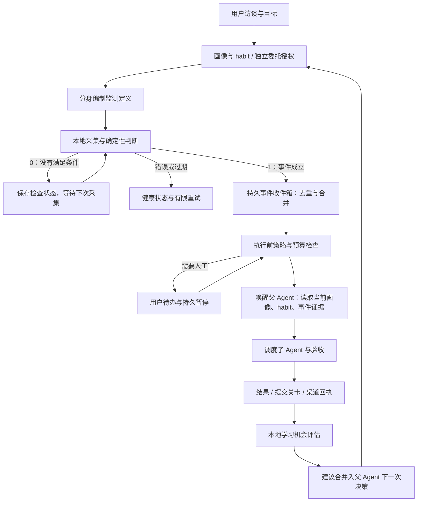

# 数字分身：技术初案与调研记录

状态：设计提案，尚未实现。调研日期：2026-11-02。源码基线：`78d4eced850b5d9265d81265bacd185891e3303e`。

**2026-11-04 更新：产品与架构以 [Your Friends 方案](YOUR_FRIENDS_DESIGN.zh-CN.md)为准。Friends 的上下文由事件执行与元认知组成，对 habit 的适用和修正负责；用户沟通由独立沟通层承接。本文中“并入 Assistant 模式”“复用连续对话历史”等旧方案不再适用，模型传输、调度、权限等基础设施仍可共用。入口放在 Assistant 下方，独立圆形展开，名称与默认进入可设置；产品不以会话、目标、任务或独立关注计划组织。本文保留前期架构论证与竞品调研，habit、权限、检测与恢复等底层设计仍供实现参考。**

本轮先确定完整方案，不修改运行时或 App 行为。本文将用户提出的身份访谈、habit 主导的个性化、父子 Agent、事件触发和能力学习组成一个可逐步交付的产品。下文“拟新增”均为目标设计，不能当作当前能力。

## 2026-11-02 推荐初案（交互模型已更新）

推荐采用：**一个持续身份的父分身，由本地事件运行时激活，依据有来源的 habit 作出决定，调度子 Agent 执行，并在结果验证后积累能力。** 持续的是身份、目标、委托和记录；模型只在需要决策时运行。此处是推荐设计，尚不是用户确认后的实现承诺。

### 产品与架构决策

| 决策 | 推荐落点 |
| --- | --- |
| 产品入口 | 在个人助手中启用数字分身；复用对话、任务、权限和插件基础，新增目标、关注事件、待办、画像和成长视图 |
| 分身数量 | 每位用户一个父分身，工作／生活作为有范围的角色；父级统一协调，子任务并行执行 |
| 长期状态 | 分开存放身份与角色、目标、habit、事件／执行证据、能力版本；委托授权由宿主独立管理 |
| 身份初始化 | 渐进访谈、具体事例、情境校准、复述确认；形成可修改的画像和第一份关注计划 |
| habit 地位 | 在适用情境的偏好决策中优先；当前要求、证据来源、反例与时效先于分数；代理采纳不冒充真人确认 |
| 目标到行动 | 以“关注计划”连接目标、检测器、执行策略和汇报策略；计划有解释、依赖、期限和完成条件 |
| 事件执行 | 受控采集＋本地判断→持久收件箱→授权与预算检查→父级决策→子任务→结果与交付回执 |
| 自主程度 | 推荐初始选择为“明确范围内自主，重要结果通知”；另提供逐次询问与完全委托，已经授予的权限持续生效 |
| 学习方式 | 本地规则发现机会，父级决定是否提炼，版本化暂存和验证后生效；日常机会等下次决策合并处理 |
| 首版出口 | 身份、habit 决策、本地事件、父子委派、授权、App 内交付、基础 skill 学习和已有插件能力发现形成完整链路 |

### 关注计划是连接目标与执行的核心

用户交代目标后，父分身先形成一份可读的关注计划，再由宿主将已授权部分激活。其内容包括：

- **目的与范围**：为什么关注，关联哪个目标和哪些 habit，适用于哪个角色。
- **事件条件**：使用哪个来源、何时检查、什么变化才成立、如何区分无变化与检查失败。
- **响应方式**：触发后由谁做什么，成功如何验证，哪些情况应记录无需行动。
- **委托与沟通**：执行前和提交前的关卡，结果渠道、通知频率、预算与静默时间。
- **生命周期**：何时结束或复核，如何暂停，依赖的偏好变化后哪些部分需要更新。

“喜欢 NBA”首先是画像中的兴趣；“帮我关注明天相关比赛，赛前提醒”才构成可直接编制的目标。用户可以授权分身主动把相关兴趣转成关注计划；在这类持续委托存在时，后续计划不必每次再请用户确认。兴趣本身不应悄悄变成无限数量的订阅。

例如用户纠正“以后不要告诉我比分”，系统不仅增加一条 habit，还要找到依赖这一偏好的提醒计划、结果模板和待发送内容，使后续处理采用新版本。用户界面提供“仅这次”“以后都这样”“只用于这个角色”等纠正范围，避免一次反馈被无限泛化。

关注计划引用既有总体目标／任务计划，不另造独立的目标执行引擎。父级依据事件与计划恢复上下文，不能依赖“模型应该记得昨天聊过”。

### 首版交付边界

第 12 节 A、B、C 是内部实施顺序；**首个面向用户的完整试用版应至少包含 A＋B＋C 的基础闭环**。学习是此次产品的核心价值，不能在交付身份页面与自动化后把它全部留给未来。

首版支持有限种受控来源、离线判断脚本、App 内通知、父级处理子任务请求、habit 修订和一种可验证的 skill 创建／更新流程。已有插件先支持能力发现、相关性建议、授权范围内的既有安装／连接流程与真实连接状态。微信等外部渠道随具体适配器接入；任意新插件代码生成、更多外部来源和多宿主扩展按 D 阶段推进。

交付前必须证明三件事：无事件时模型调用数为零；事件到执行与交付能够恢复、去重和撤权；真实用户的纠正能改善下一次行为，而且不会把分身自己的选择写成用户确认。

## 1. 判断与产品定位

这个方向值得做：将用户的长期目标和工作方式，转化为可以持续执行、及时纠正的委托关系。用户不必反复启动聊天、重述偏好、分配子任务和查看所有执行过程。

但核心架构已有相近实现，尤其 Hermes 已有脚本预检查后决定是否唤醒模型、持久记忆和 skill 自我修订。不能把“事件触发＋记忆＋多 Agent”作为独有创新。CardBush 应验证的产品优势是：**分身是否更准确地代表这个用户，是否减少用户介入，且用户能理解、纠正和撤回它的决定。** 这是一项待验证的差异化目标，不是已建立的竞争壁垒。

数字分身是一个有持续身份、目标和授权的父 Agent。界面上它可以占据过去由用户承担的任务指挥位置；运行时中，它仍然是“代表用户的代理”，真实用户和代理的来源不可混淆。允许用户授予很宽的自治范围，不要求对已经授权的操作重复询问。

默认每位用户一个分身，内部有工作、生活等情境角色。先不引入多个相互独立、同时拥有全部权限的分身，避免偏好、审批和资源竞争。兴趣列表只是访谈的一部分；项目目标、责任和利益冲突同样决定分身应关注什么。

### 1.1 主要优点，以及成立条件

| 优点 | 对用户的价值 | 成立条件 |
| --- | --- | --- |
| 事件成立才推理 | 高频检查可以不产生模型调用，减少空转 | 检测条件可计算，采集器本身不偷偷调用模型 |
| habit 贯穿执行 | 下一次少解释格式、渠道、取舍和工作方法 | 有适用范围、来源、纠错与失效机制 |
| 父 Agent 管理子 Agent | 用户交代目标，分身分工、处理一般问询、验收结果 | 授权清晰，子任务上下文充分，失败能上报 |
| 从经验提炼能力 | 重复工作逐步成为可复用 skill 或确定性工具 | 以真实结果验证改进，保留旧版本与回滚 |
| 用户拥有干预入口 | 用户外出时仍可委托，必要时只处理少量关键决定 | 能暂停、撤权、调整通知，并看到未处理事项 |

等待期“零模型调用”不等于系统零成本：本地 CPU、网络、数据源、脚本维护仍有成本，建立监测器、事件后的执行和经验总结也会花 token。若原来检查 N 次都用模型，现在只在 M 次有效变化时调用，则节省的是被省去的 N−M 次检查推理，再扣除配置、维护、学习成本；不能预先承诺固定节省比例。

## 2. 已有类似实现：哪些已经被做过

以下依据官方文档与官方仓库资料；本轮没有部署这些产品做端到端实测。官网描述、源码主分支与已安装发行版可能不同，“本次资料未确认”也不等于该产品没有能力。

| 产品／框架 | 已有的相近能力 | 与本方案的关系和证据边界 |
| --- | --- | --- |
| **Hermes Agent** | cron 前置脚本可输出 `wakeAgent: false`，跳过本次模型调用；另有纯脚本任务。支持持久用户记忆、创建与修订 skill，以及将 skill 写入暂存待审 | 是本次查到与“本地判断→唤醒→经验沉淀”非常接近的实现。不能宣称此闭环无人实现；是否具有本方案完整的身份访谈、habit 决策解释和父级授权 UI，需要另行实测。[任务预检查](https://hermes-agent.nousresearch.com/docs/user-guide/features/cron)、[技能管理](https://hermes-agent.nousresearch.com/docs/user-guide/features/skills)、[记忆](https://hermes-agent.nousresearch.com/docs/user-guide/features/memory) |
| **OpenClaw** | 用户画像 `USER.md`、自动化任务和 webhook；standing intents 支持事件条件记忆，用本地关键词检索、范围和冷却规则匹配，无须在匹配路径调用模型 | 是持续个人 Agent 的直接对照。standing intents 的证据主要针对传入用户对话，不能据此认定任意外部爬虫也能零推理判定；定时唤醒本身也不意味着免费。[用户模型](https://docs.openclaw.ai/concepts/user-model)、[条件记忆](https://docs.openclaw.ai/concepts/standing-intents)、[自动化](https://docs.openclaw.ai/automation) |
| **Letta** | 可持续编辑的记忆，以及后台 dreaming 对近期对话进行整理和经验沉淀 | 值得参考长期记忆的生命周期；后台整理仍涉及推理，不能等同无 token 等待，也不能证明其已准确复刻某个用户。[记忆配置](https://docs.letta.com/configuration/memory) |
| **OpenHands** | 事件自动化、webhook、确定性事件匹配，把事件转成工程 Agent 工作 | 与“发现 bug 后启动修复”接近。文档区分本地 Agent Canvas、Enterprise 和 GitHub 集成的适用范围；不是所有版本都具备同一连接能力。[事件自动化](https://docs.openhands.dev/openhands/usage/automations/event-automations) |
| **LangGraph／Ambient Agents** | 对事件流反应，结合通知、询问与审阅；中断机制可持久保存状态，待外部输入恢复 | 提供可借鉴的架构与实现机制，不能当作完整的个人数字分身产品。[Ambient Agents](https://www.langchain.com/blog/introducing-ambient-agents)、[持久中断](https://docs.langchain.com/oss/python/langgraph/interrupts) |

本方案应重点对标 Hermes 的前置检测与 skill 学习、OpenClaw 的个人上下文、Letta 的记忆演进，以及 OpenHands 的工程事件闭环。不因发现同类产品而放弃，也不把组合这些组件本身当成已经证明的优势。

## 3. 身份建立：以具体经历理解用户

访谈采用情境访谈、具体事件回顾和复述确认的方式，借鉴人类学关注生活情境、心理学关注取舍与行为证据的思路。这是产品访谈设计，不是人格诊断，也不声称一次访谈就能复制用户人格。

用户可以跳过问题、修改答案、指定内容不保存。先形成可用的最小画像，再在实际委托中补充；不以冗长问卷作为使用门槛。

| 阶段 | 交流内容示例 | 形成的内容 |
| --- | --- | --- |
| 目标与角色 | “你希望我接手哪些事？哪些角色或责任最重要？” | 长期目标、当前项目、角色范围 |
| 日常情境 | “回顾最近一次你希望有人代办的事情，当时怎么决定的？” | 具体流程和决策证据 |
| 利益与取舍 | “速度、成本、质量发生冲突时，你通常怎样取舍？有哪些例外？” | 条件偏好与反例 |
| 兴趣与信息来源 | “你关注什么？哪些渠道可信？哪些内容希望避开？” | 主题、来源、信息边界 |
| 沟通方式 | “何时可以打扰你？简报还是详细过程？通过什么渠道？” | 频率、时间、格式、目标渠道 |
| 委托边界 | “哪些事情我能自行决定？哪些必须先问？完成后哪些必须告诉你？” | 可审阅的授权草案，独立于画像 |
| 情境校准 | 给出赛事、工作故障、日程冲突等少量场景，让用户纠正分身的拟定选择 | 决策样例，不只收集性格形容词 |
| 复述确认 | 展示“我理解的你、准备关注的事件、仍不确定的地方” | 用户确认的画像版本、首批订阅与授权 |

人格描述如“喜欢简洁”必须转成可操作、可纠正的条件规则；“喜欢 NBA”不能自动推出喜欢所有球队、每天接收消息、接受剧透或愿意付费。用户沉默不能算确认。生活偏好不自动适用于工作角色。

### 3.1 系统上下文的组成

宿主编译一份有长度预算、带版本的“重要用户画像”上下文，包含已确认身份、当前角色、目标及关键偏好。它用于稳定指导行为，不赋予越权能力。按事件再检索相关 habit 和必要历史，不把全部聊天、全部记忆永远塞进提示词。

长期连续性来自持久记录、版本、检索与摘要；每次唤醒仍有有限上下文。原始外部内容保留来源与不可信数据边界，不能通过“总结”自动升级成系统指令。具体模型消息适配遵循现有 provider 能力，不把权限检查放进一段提示词里。

## 4. habit 应如何拥有高权重

habit 要影响四个阶段：**关注哪些事件、怎样完成任务、怎样沟通结果、哪些经验值得沉淀。** 它是决策的重要依据，不只是检索后附在末尾的一段参考。

先筛选适用性，再排序，不用一个统一的高分覆盖所有规则：

1. 排除不属于当前用户／角色／任务范围、已撤销、已过期或已被替代的条目。
2. 区分用户明确表达、用户确认总结、基于观察的推断，以及分身自行选择。来源不因被重复引用而改变。
3. 在可用授权范围内，当前明确要求优先；相关、已确认的偏好优先于一般默认策略。新目标与长期偏好冲突时，按上下文解决或提出一个具体问题，不用分数强行掩盖矛盾。
4. 同等级候选才比较情境匹配、证据强度、最近纠正和时效性。解释展示“采用了哪条偏好，为什么适用”，不展示缺乏校准依据的伪精确人格分数。

权限是独立约束：知道用户喜欢某种行动，不等于已获准执行。用户可以另行授予完全自治，授权与偏好分别记录。

拟扩展 habit 元数据：`scope`、`provenance`、`evidenceIds`、`confidence`、`confirmedBy`、`revision`、`validUntil`、`supersedes`。其中 `confirmedBy=human` 只能来自可验证的真实用户操作；分身可在被授权时采纳推断，但标记为 `delegated` 或 `inferred`，不能伪造成用户原话。

关键防漂移规则：

- 一次任务的多个模型轮次、同一原始证据的多次摘要、父子 Agent 相互引用，不构成多份独立用户证据。
- “任务完成”能支持流程有效，不能单独证明用户喜欢该流程；没有投诉也不等于喜欢。
- 支持例外、反证、遗忘和恢复旧版本。删除或纠正 habit 后，找出依赖它的订阅、skill 和待执行计划，按依赖关系失效或重评。
- 向用户展示不确定的推断；高影响、证据冲突且不可从现有偏好解决时再问。普通学习建议可合并到下一次自然交流。
- 不仅评估“像不像以前的用户”，还看是否完成用户当前目标；分身应帮助用户改变习惯，而不是把旧习惯固化。

## 5. 父 Agent 如何代表用户

新增宿主可信的决策身份：`human`、`digital_twin`、`detector`，代理携带 `actingFor` 与授权链。此身份来自宿主认证／会话绑定，不能由模型工具参数自行声明。

父 Agent 接收子任务进展、问题、权限请求及学习建议。已有答案的偏好问题由父 Agent 根据画像回答；范围内的执行授权由父 Agent 决定；需要真实用户输入的项目进入同一个待办队列。审计记录保留“由分身代表用户批准”。不能把模型输出写成一条真实用户消息来获得用户权限。

有效执行范围取用户委托、当前事件范围、实际执行主机准入和子任务工具范围的交集。完全授权可以覆盖用户可授予的全部可用能力，但不能扩张远端管理员范围、创造未连接的账号或伪造第三方认证。

### 5.1 三个相互独立的选择

| 设置 | 含义 | 示例 |
| --- | --- | --- |
| `beforeExecution` | 事件发生后能否自行开始执行；可继承总体策略、自主或先问用户 | CI 故障可自行排查；特定事件每次必须先问 |
| `beforeExternalCommit` | 若配置此关卡，在发送、发布、支付等具体提交动作前批准 | 可以自行写补丁，但合并前先问；可以写消息草稿，但发出前先问 |
| `reportPolicy` | 结果是否必须告诉用户：始终、重要时、汇总或静默 | 每场指定比赛都通知；一般维护加入日报 |

用户描述的“结果必须提交用户”主要落在 `reportPolicy`。如果“后授权”指先审阅结果再对外生效，则使用提交前关卡。事后汇报不能撤回已经发送或发布的内容。

完全自治模式下，已覆盖的操作直接执行，父 Agent 也可按授权采纳学习建议。只有超出范围、被用户指定为必须人工处理、缺少凭据或关键事实无法判断时才转交用户。批准绑定具体操作、资源、有效期及版本；内容扩大后原批准不能复用。

撤权需要让排队任务、待审批操作和下一次工具调用检查最新授权代次。已运行任务按能力停止；已经发生的外部副作用不能承诺自动撤回，UI 必须给出实际状态。

## 6. 事件驱动架构



图中的等待和检查是普通程序调度，不是模型思考循环。学习建议不会因为自身被创建就无限唤醒父 Agent。

### 6.1 监测器与触发协议

首版使用“宿主采集器＋离线判断脚本／声明式规则”。优先使用可用的 API、webhook、RSS、文件和 CI 事件；爬虫是其中一种适配方式。分身可以委派子 Agent 生成脚本和测试样本，宿主验证后激活。

`DetectorDefinition` 指定目标、来源、采集计划、时区、范围、规则／脚本哈希、解释、凭据引用、预算、去重键、失效时间和关联 habit 版本。脚本检查后的业务结果满足用户希望的 1/0，但协议另外区分错误：

```json
{
  "schemaVersion": 1,
  "detectorId": "nba-following",
  "detectorRevision": 3,
  "observationId": "source-revision-42",
  "observedAt": "2026-11-03T00:00:00Z",
  "status": "ok",
  "trigger": 1,
  "dedupKey": "game-id:reminder-window:revision-42",
  "expiresAt": "2026-11-03T02:00:00Z",
  "facts": { "gameId": "game-id", "sourceChanged": true },
  "evidenceRefs": ["observation:source-revision-42"]
}
```

`status=error|stale` 时 `trigger=null`；不能把超时、解析失败、登录失效当作“没有事件”。`trigger=1` 表示规则被满足，不代表网页内容天然真实。宿主验证 schema、大小、时间、来源身份、检测器版本和重复键；来源身份不信任脚本自报。

为了让“检测阶段不花模型 token”可验证：采集器不接推理服务，离线判断进程无网络、不继承模型凭据；必要网络由宿主受控采集代理承担。规则对未知语义无法判断时先记录不确定，或进入明确计费、限额的语义评估通道，不能把隐藏的模型判断称作免费。

当前命令沙盒只有网络启用／禁用，并没有可直接复用的域名白名单保障。首版需实现受控采集代理，校验目标、重定向和地址变化；不以设置代理环境变量冒充强制网络隔离。检测脚本按独立受限策略执行，不因父 Agent 完全访问而变成普通无限制进程。能力不支持时不能静默降级。现状见[命令沙盒](EXECUTION_SANDBOX.md)。

### 6.2 事件收件箱与恢复

事件先持久化，再唤醒模型。保留从观察、触发、准入、执行到交付的因果 ID。事件状态可概括为：`received → admitted / awaiting_approval / suppressed / expired → running → completed / failed / no_action`；通知交付另有状态，避免“任务做完”等同“消息送达”。

- 重复事件幂等；有意义的新版本才产生新工作。对同一对象的短时变化合并，不能仅靠固定冷却时间丢弃重要更新。
- 父 Agent 每个分身串行处理决策；子任务按既有额度并行。忙碌时新事件留在收件箱，按规则合并，不能直接丢失。
- 重启恢复待办和未决事件；多个宿主使用单一所属主机及租约／代次，防止桌面与服务重复消费。
- 支持暂停、有效期、补跑策略、静默时段、每日唤醒与 token 预算。错过赛事提醒时可丢弃过期提醒；代码故障可按策略保留，不能统一补跑全部历史。
- 停止事件、学习更新、子任务完成都要保留因果链并限制触发深度，防止自身输出反复触发自己。
- 每个有效事件必须形成处理结论，但不要求每次都产生外部副作用。过时事件、已修复故障可以记录 `no_action` 及理由。

使用持久交付 outbox 和渠道幂等键。通用网络无法保证绝对“恰好一次”：对已发出但未收到确认的操作记录 `delivery_unknown`，优先查询确认，不能盲目重试造成重复消息或重复发布。

### 6.3 本地运行的真实边界

桌面 Runtime 活着时才能采集；独立 Agent 服务可以不依赖桌面窗口，但机器休眠、关机或断网仍会影响运行。UI 区分“等待事件”“监测器故障”“主机离线”，不显示一切正常。需要持续在线可选择已有远程 Agent 宿主，由该主机自己的授权与凭据执行。

公网 webhook 无法直接访问本机 loopback。接入时明确选择可达的受信入口、经过配置的中继，或改用轮询；连接方式必须实际验证，不能只保存一个本地 URL 就宣称订阅成功。

## 7. 本地评估器与 skill／插件学习

“本地评估机器”首先是 Runtime 内的服务，无需另外购置一台机器。它消费执行和反馈的结构化记录，使用本地统计与规则发现学习机会。模型负责在被需要时理解、提炼和设计；不能把需要语义推理的总结包装成完全无 token 的本地规则。

### 7.1 什么会触发学习建议

| 信号 | 本地可计算的依据 | 建议去向 |
| --- | --- | --- |
| 重复成功工作 | 不同任务中的相似工具步骤、相同产物类型、可核验的成功结果 | 提炼或更新 skill |
| 相同纠正反复出现 | 独立用户输入中相同格式、来源或取舍被纠正 | 建立／修订有范围的 habit |
| 多轮低效 | 反复重试、重复查询、相同缺失依赖、耗时与调用数上升 | 分析流程缺陷；不能直接把失败步骤固化为 skill |
| habit 已相关却未采用 | 决策引用、选择结果与适用的已确认偏好不一致 | 排查检索／冲突处理，必要时询问用户 |
| 长期能力缺口 | 多次请求同一外部服务，且安装目录没有对应能力 | 推荐插件、创建适配器草案或提示连接所需账号 |
| 现有能力失效 | skill 回归、插件接口变化、监测器持续解析失败 | 暂停、修复或回滚，而非继续自信执行 |

“多轮次”是线索，不是创建 skill 的充分条件。首版可用不同任务数、重复步骤和验证结果的可配置阈值筛选；具体阈值经回放校准，不假装已经有可靠的通用公式。需要语义相似度时优先复用已有可用证据，另行注明本地模型或远程嵌入的成本。

每个机会生成 `LearningProposal`，附原始证据、关联 habit、预期收益、改动范围和验证方法。相同机会去重，用户拒绝后设置冷却；没有新证据或改动范围就不重复询问。日常建议合并到父 Agent 下一次活动或低频回顾；需要立即修复的故障才按事件预算唤醒。

### 7.2 三类学习产物

| 产物 | 解决什么问题 | 不能混为一谈的内容 |
| --- | --- | --- |
| habit | 用户在特定情境下偏好什么、如何取舍 | 工具成功不等于用户认可；推断不等于用户确认 |
| skill | 可复用步骤、检查点、失败处理和产物格式 | 保存一段总结不等于已经提高执行成功率 |
| 插件能力 | 可调用的外部连接、工具、事件源和交付渠道 | 总结插件说明不等于安装、登录和授予访问权；生成代码不等于连接可用 |

支持两种插件工作：发现和接入已有插件；在无合适能力时生成新适配器草案。后者包含代码、能力声明、权限、测试、版本和卸载／回滚策略，工程成本明显高于生成 skill。首版先闭环已有插件接入，后续再开放任意插件生成。

### 7.3 从建议到生效的状态机

`candidate → reviewed → staged → validated → active → retired / rolled_back`。

1. 本地评估器创建候选。父 Agent 收到与用户相同的可审阅信息；是否需要真人按学习授权决定。
2. 生成具体差异：新 habit 的依据、skill 的步骤变更、插件的新增能力与账号范围。授权对象是可复核的版本，不是一句“让自己更聪明”。
3. 子 Agent 在隔离环境生成／修改产物；去除凭据、私人对话和无关用户身份，避免把日志整段写入 skill。
4. 用历史样本回放和独立样本验证；结构合法只是第一步，还要检查产物正确、失败路径、工具范围和副作用。高影响修改不能只凭生成者自评生效。
5. 在授权范围内激活精确版本；后续任务比较效果，失败可退回旧版。同一条执行记录不能既作为唯一训练依据，又作为唯一改进证明。

完全授权时，父 Agent 可以自行通过上述流程，不需要把每个建议都打断式交给用户。涉及新增账号认证、额外范围或明确人工关卡时，再把具体方案交给用户。外部平台要求用户认证的步骤不能由分身自称已完成。

自我改进的含义是更新外部记忆、流程和工具，不是自动训练模型权重。首版不让分身改写宿主权限执行代码、可信身份或自己的授权上限。

## 8. UI：一个可委托、可纠正的角色

在现有个人助手基础上增加“数字分身”模式，继续复用对话和任务展示，不另建第二套互不相通的聊天系统。

| 区域 | 用户看到什么 | 关键交互 |
| --- | --- | --- |
| 首次进入 | 逐步访谈、画像复述、计划关注的事件、委托范围 | 跳过、修改、不保存、确认并启动 |
| 主页面 | 当前目标，以及等待事件／处理中／等你决定／暂停／离线状态 | 直接交代目标、纠正分身、一键暂停 |
| 事件时间线 | 什么发生了、为什么关注、采用了哪些偏好、做了什么、是否交付 | 展开证据、查看子任务、调整此类事件 |
| 待你决定 | 真正需要用户的执行批准、缺失信息、认证和冲突 | 批准一次、明确扩大未来范围、拒绝；展示有效期与操作对象 |
| 我的画像与 habit | 确认偏好、推断、来源、例外和修订历史 | 修改、忘记、恢复、查看影响到哪些订阅和流程 |
| 关注事件 | 来源、触发条件、上次检查、下次检查、健康状态与主机 | 暂停、测试、调整频率、查看检查为何没触发 |
| 能力成长 | skill／插件／habit 建议、验证结果、生效人及收益 | 查看差异、采纳、拒绝、回滚、设置以后由谁决定 |
| 子任务面板 | 父子关系、进度、等待依赖和验收结果 | 复用现有任务详情；不强迫用户打开大量聊天 |

同一个决策组件支持“由用户决定”与“由分身决定”的记录和路由；由分身处理的卡片可以折叠进入时间线，真正的人类待办保持精简。不能因为设置静默就隐藏执行记录或故障状态。

“为什么这样做”只展示决策依据、来源和结果说明，无须暴露模型内部推理过程。画像、证据和凭据也不应默认通过通知发送给外部渠道。

UI 实现必须遵循 [i18n 约束](../src/i18n/README.md)：所有自有文案进入全部发布语言包，日期／数字按语言格式化；状态、窄屏和主题表现用 CSS 变量及语义 class。本文中的中文文案只是设计示意，不能直接硬编码进组件。

## 9. 如何落到当前 CardBush

当前已有重要底座，但尚没有本方案完整闭环。必须沿既有 Runtime、权限和持久化机制扩展，避免另外建立一个拥有不同授权逻辑的无限循环 Agent。

### 9.1 已有能力与缺口

| 现有位置 | 已核对的能力 | 拟增加／修正的内容 |
| --- | --- | --- |
| [assistantConversation.ts](../packages/bush-runtime/src/assistantConversation.ts)、[架构说明](ARCHITECTURE.md) | 固定 `personal-assistant` 身份、独立对话记录和模型历史、任务回执与上下文整理 | 增加分身身份、目标／画像版本、事件入口和激活状态；继续复用有限上下文与持久历史 |
| [automationScheduler.ts](../packages/bush-runtime/src/automationScheduler.ts)、[automation.ts](../packages/bush-protocol/src/automation.ts) | once／interval／内部事件触发、插件唤醒、持久作业、冷却与并发控制 | 在启动 Agent 前增加检测阶段；补持久事件收件箱、忙碌期合并和幂等派发；普通 interval 任务不能冒充无 token 轮询 |
| [individuationStore.ts](../packages/bush-runtime/src/individuationStore.ts)、[individuationContext.ts](../packages/bush-runtime/src/individuationContext.ts) | SQLite habit／证据／反馈、版本与来源、有限预算检索；历史记忆不是当前授权 | 扩展角色、证据等级、依赖索引和决策引用；保持来源边界，不把高权重解释成提权 |
| [individuationMemory.ts](../packages/bush-runtime/src/individuationMemory.ts)、[assistantMemory.ts](../packages/bush-runtime/src/assistantMemory.ts) | 已有模型辅助整理；后台完成通知不得创建／纠正用户偏好 | 增加基于证据与委托权限的候选学习入口；不直接删除 `memory_requires_user_input` 检查，也不伪造新用户消息绕过它 |
| [runtimePermissionBroker.ts](../packages/bush-runtime/src/runtimePermissionBroker.ts)、[localSubagentInteractions.ts](../packages/bush-runtime/src/localSubagentInteractions.ts) | 既有权限 broker；子任务的父级委托／人工路由 | 接入分身 principal、持续委托与撤权；保留操作绑定和远端准入，不能另造独立审批队列 |
| [subagentTool.ts](../packages/bush-runtime/src/subagentTool.ts)、[子 Agent 配置](SUBAGENT_PERMISSIONS.zh-CN.md) | fork／clean、任务续接和子 Agent 权限基线；注册子 Agent 关闭独立 habit／prediction 能力 | 新增分身任务的最小必要上下文策略。普通 fork 会复制历史，仅关闭记忆检索并不能阻止画像随历史下发 |
| [pluginSkills.ts](../packages/bush-runtime/src/pluginSkills.ts)、[pluginAcquisition.ts](../electron/pluginAcquisition.ts) | 现有 skill、插件发现和安装基础 | 新增学习建议、暂存、验证、生效、回滚的受控管理能力；不能只新增 prompt 而没有真实管理接口 |
| [Assistant Webhook](WEBHOOK_BOT_PROTOCOL.md) | 通用 HTTP 消息和平台桥 | 通过 Assistant 收发消息并委派桥工具。 |
| [AssistantView.tsx](../src/features/assistant/AssistantView.tsx)、[AutomationPanel.tsx](../src/features/automations/AutomationPanel.tsx) | 助手、权限卡、任务与自动化界面 | 增加访谈、事件时间线、画像和能力成长入口，复用状态与详情组件 |

既有助手直接管理工具是有限白名单，包含排期与目录检索等管理能力；终端与文件工作继续交给子任务。新增 `detector`、`twin_profile`、`learning_proposal` 等管理接口时，通过原 `ToolExecutionCoordinator` 的声明、准入、权限和回执路径实现，不能暴露通用越权执行入口。

### 9.2 拟新增契约和存储

以下为逻辑契约，实际命名在实现时统一；新增字段采用版本化 schema，未知权限字段拒绝接受。

| 契约 | 核心字段／职责 |
| --- | --- |
| `TwinProfile` | owner、revision、目标、情境角色、用户确认摘要、未确认推断、访谈证据引用 |
| `DelegationGrant` | issuer、delegate、资源／操作范围、主机、关卡、有效期、撤权代次；凭据不写入画像 |
| `WatchPlan` | 既有目标引用、角色、关注原因、habit 依赖、检测器引用、响应与交付策略、预算、期限和完成条件；不另建目标执行引擎 |
| `DetectorDefinition` | 采集器、规则版本／哈希、调度、时区、授权引用、预算、依赖 habit、过期与补跑策略 |
| `EventOccurrence` | 稳定事件 ID、来源、证据、对象与版本、检测结果、因果链、合并关系和执行状态 |
| `TwinDecision` | eventId、决策身份、目标／画像／habit／grant 版本、选用能力、结论与产物引用 |
| `LearningProposal` | 类型、独立证据、具体差异、关联偏好、审阅者、验证记录、生效版本及回滚关系 |
| `DeliveryReceipt` | eventId、产物版本、渠道、幂等键、尝试与确认状态，区分发送失败与确认未知 |

拟在所属宿主的数据目录增加 `TwinStore`（SQLite），保存关注计划、事件收件箱、画像版本、决定、建议和 outbox；habit 仍由 `IndividuationStore` 负责，凭据仍由现有连接／配置边界管理。UI 的 localStorage 不作为授权或完整个人档案的权威存储。按 owner 隔离，远端只接收任务需要的上下文。

不强制迁移全部现有自动化 JSON 数据。新增事件派发桥以稳定 `eventId + actionRevision` 幂等入队；同一数据库内先事务写入待派发记录，原调度器需新增持久幂等接收与查询能力，确认后再更新收件箱。两份存储之间不能假装有原子事务；启动恢复通过稳定 ID 对账，处理“已派发但未记录确认”的崩溃窗口。

画像变更采用 revision 比较后写入，保留差异与来源。执行开始装配当前有效上下文；准备外部提交时再次验证相关授权和依赖。与任务无关的画像修订不应使全部运行任务重启；与操作相关的撤权和偏好修正必须阻止过时提交。

### 9.3 父子上下文与能力协商

普通 fork 的现有合同是复制父历史，不能悄悄重写它。分身模式拟增加宿主控制的 `task_scoped` 委派上下文策略，作为明确的新协议能力：只下发任务、必要事实、相关偏好、交流语言和委托上限；不下发整份身份访谈。既有普通 fork／clean 语义不变，不能仅靠 prompt 声称已经隔离。

协议协商增加如 `digitalTwin.v1`、`detectorGate.v1`、`taskScopedDelegation.v1` 的能力标识。名称是设计占位，不是当前已暴露字段。远端缺少必要能力时，显示不支持，或选择已有能力能够满足的显式流程；不能静默使用更宽权限或把模型审批假扮成人工审批。现有禁止子 Agent 递归派发的边界继续保留，任务拆分由父级协调。

默认不迁移出一个自动启用的分身：原助手、habit 开关与普通定时任务行为保持兼容，用户启用模式后再建立画像和委托。禁用分身会暂停其监测与待执行事件，保留可审阅的历史；删除提供画像、habit 依赖、衍生产物和日志的处理范围说明。

## 10. 两条端到端场景

### 10.1 赛事信息

1. 访谈确认用户关心的赛事范围、可靠信息来源、时区、提前量、是否接受比分／剧透以及接收渠道；未知项不自动补成偏好。
2. 分身创建受限采集配置和本地判断脚本，准备“无赛事、赛事出现、时间变更、源故障”样本。测试通过并满足授权后激活。
3. 等待期间按计划采集。正常无变化返回 0，不组装模型请求；错误单独记录与有限重试。
4. 相关赛程进入提醒窗口时返回 1，宿主按赛事 ID、提醒窗口及有意义的变更版本去重，持久化事件。
5. 父 Agent 被唤醒，读取当前偏好与授权，决定摘要格式、必要的补充检索和交付渠道。可直接处理管理决策，复杂获取由子任务完成。
6. 走真实安装并认证的渠道适配器发送，保存回执。微信插件未连接时进入待接入／交付待办，不能宣称消息已送达。
7. 用户纠正“以后不要比分”，形成可追溯的偏好修订，并影响之后的订阅和交付；仅仅发送成功不会强化“用户喜欢看比分”。

如果消息完全可由固定模板和事实生成，可以直接确定性交付，不为展示“分身在工作”而额外唤醒模型。

### 10.2 工程故障

1. 已授权的 CI／问题源送入具备可验证来源的故障事件，带仓库、分支、构建版本和日志证据。
2. 本地规则过滤重复、已关闭和不属于委托范围的故障；执行前策略要求人工时先挂起，等待批准不占用模型循环。
3. 父 Agent 将修复目标、相关工程偏好和权限交给子 Agent；代码工作与验证使用隔离工作副本及实际执行主机的权限。
4. 以失败复现、修复和相关测试结果验收；子 Agent 说“已解决”不是充分证据。故障原因不明或权限不足时回到父级处理。
5. 根据委托，可停在补丁、草稿 PR，也可进行已授权的后续提交；部署等动作遵循其具体关卡，不能从“允许修 bug”无限外推。
6. 按用户选择强制汇报、重要时汇报或加入汇总。经过多个独立任务验证的修复流程，才成为 skill 候选。

## 11. 未来风险：优先解决什么

habit 权重越高、自治时间越长、接入能力越多，下列问题的影响越大。它们是架构与产品取舍，不应只在最后增加一段“注意安全”。

| 风险 | 具体如何发生 | 设计措施 | 仍然存在的限制 |
| --- | --- | --- | --- |
| **把自己学成自己** | 分身作出选择，再将自己的选择当作用户证据，循环强化错误偏好 | 真实用户、代理、工具来源分离；独立证据计数；反证、版本、撤销和依赖失效 | 用户很少纠正时，系统仍难以判断偏好是否准确 |
| **高权重记忆被污染** | 网页、日志、插件返回内容经摘要进入 habit，之后长期影响行动 | 外部材料不能建立授权；保留原始出处；记忆写入受控；可执行工具的范围在宿主检查 | 语义操纵无法仅靠提示词或一次审阅完全消除 |
| **偏好漂移与角色冲突** | 旧偏好压过新目标，生活习惯套用到工作，分身持续迎合用户的过去 | 情境范围、例外、时效、冲突提示；用户可表达“这次刻意改变习惯” | “更像用户”没有一个永远正确的固定标准 |
| **关注范围越来越窄** | 只检索既有兴趣，再把看到的内容当作偏好强化证据，遗漏用户尚未表达的新需求 | 检索范围可见可改；兴趣与重要事项分开；新主题探索由用户选择 | 系统不能从未观察到的内容中推断真实需求 |
| **代理身份变成提权通道** | 父 Agent 把自己回答写成用户许可，子任务通过新会话扩大权限 | 宿主身份、委托交集、操作绑定、撤权代次和真实审批来源 | 已发生的外部动作无法靠撤权自动逆转 |
| **本地监测漏报／误报** | 网站改版、时间区间错误、登录过期、机器休眠被当作无事件 | 错误与 0 分离；样本测试、健康状态、主机可用性和明确补跑策略 | 本地离线期间不能承诺实时响应；上游也可能提供错误信息 |
| **重复执行与事件风暴** | webhook 重送、条件一直为真、重启丢失去重状态、修复触发自身 | 持久幂等、边沿／变更语义、合并、因果深度限制、预算和暂停 | 不支持幂等或查询的外部服务可能留下结果未知 |
| **自我改进造成回归** | skill 把偶然成功固化，生成插件引入错误，更新权限超出预期 | 暂存具体版本、回放与独立验证、限定激活范围、可回滚 | 回滚代码不能撤回已发消息；历史样本不覆盖全部未来情境 |
| **模型升级改变行为** | 画像未变，但模型或摘要策略升级后对同一情境做出不同决定 | 记录模型与上下文版本；升级前回放关键情境；保留受支持的回退路径 | 生成结果有波动，不能保证永久完全一致 |
| **隐私与插件供应链** | 完整画像下发所有子任务，第三方插件获取广泛资料，凭据混进总结 | 最小任务上下文、owner 隔离、凭据引用、包与版本校验、安装范围可见 | 外部服务依然拥有收到的数据；本地存储也需要真实的设备保护 |
| **注意力与成本反弹** | 监测和学习建议越建越多，每条都唤醒模型或询问用户 | 合并建议、拒绝冷却、关注数量／唤醒／token 预算；衡量减少了多少介入 | 复杂任务的维护成本可能超过节省，需允许停用无收益自动化 |
| **过度依赖与责任不清** | 用户把“像我”误当“不会错”，之后无法解释某个对外决定 | 展示身份、依据、置信来源、真实交付和失败；保留人工接管 | 软件不能代替用户对长期目标与重大取舍的最终判断 |

持久记忆污染已有针对 web agents 的研究证据：攻击可以通过被观察的外部内容影响后续记忆和跨会话行为。这支持将“来源不会因总结而变可信”作为硬设计边界，但不能把特定实验的成功率直接套到 CardBush。[Amazon Science：环境注入式记忆污染研究](https://www.amazon.science/publications/poison-once-exploit-forever-environment-injected-memory-poisoning-attacks-on-web-agents)

隐私交付还需包含可导出、可删除、可设保留期的数据管理。删除个人画像时说明哪些摘要、skill、订阅和备份仍含衍生信息；不能只删一行数据库就宣称全部遗忘。与凭据相关的保护复用宿主安全存储能力，未实现的磁盘加密不能在 UI 宣称已开启。

## 12. 分阶段实现，而不是一次铺开所有能力

各阶段按验收出口推进，具体工期在实现任务拆解后评估。A、B 先打通事件执行链，C 补齐此次产品必需的基础学习闭环，D 扩大能力。首个完整试用版包含 A＋B＋C 的基础能力；不能把第一阶段界面或仅有自动化的版本当成完整数字分身交付。

| 阶段 | 交付范围 | 完成标准 |
| --- | --- | --- |
| **A：身份与委托基础** | 分身模式、渐进访谈、画像版本、独立授权、决策身份和用户待办；先复用现有任务能力 | 用户能确认／纠正画像；父级在授权范围内处理子任务问题；撤权不被后续任务绕过 |
| **B：最小事件闭环** | 一种受控采集器、离线判断、持久收件箱、事件到父 Agent、现有子任务执行、App 内交付、事件时间线 | 从“设定关注事项”到真实事件处理成功；等待期无模型调用；错误、重启、重复与离线状态可信 |
| **C：habit 与 skill 学习闭环** | 本地学习机会评估、父级接收建议、habit 推断来源、skill 暂存／验证／激活／回滚 | 多个独立任务产生可审阅建议；既能人工确认，也能按已给授权自治；验证未来任务效果而非只看成功写入文件 |
| **D：插件与长期运行** | 已有插件接入、实际外部通知渠道、远端／常驻宿主、插件生成的隔离试验、长期效果评估 | 至少一个真实渠道端到端确认送达；凭据、断连、失败与结果未知都可处理；通过长期回放和停机恢复验证 |

首个验证场景建议选择一个只读信息订阅，另用工程故障回放检验父子委派。它们分别覆盖低副作用的持续关注，以及复杂执行和验收。微信是可插拔渠道的后续适配，不作为最初验证事件机制的阻塞项。

### 12.1 首版默认决策

- 用户主动启用分身；访谈可跳过，未知内容保留未知。访谈生成可编辑草案，确认后启用首批订阅。
- 一位用户一个父分身，按情境切换角色。父级负责分工，保持现有子 Agent 递归限制。
- 运行前把执行与汇报策略放在同一张可审阅卡中。支持完全自治，用户选定后持续生效；学习权限也单独可见，不再逐项重复索要同一授权。
- 确定性检查为默认；语义评估、经验总结的模型调用单独计入成本。普通学习机会不立即打断用户。
- 对于不确定、冲突或尚无凭据的工作，保存明确待办；不制造“已完成”状态。静默只影响通知频率，不移除状态和审计。
- 从内置采集器和已安装插件开始，任意生成的联网脚本与插件放在后续阶段，不跳过验证直接获得宿主所有能力。

## 13. 验收：如何证明它真的更好

以下是待实现的验收要求，不是本轮已经跑过的测试结果。使用隔离数据、模拟时钟、假渠道和可计数模型接口，不污染用户画像、真实连接或通知目标。

| 范围 | 必须验证的行为 |
| --- | --- |
| 等待成本 | 推进 24 小时模拟检查、条件均不成立，主模型／辅助模型／远程嵌入调用数均为 0；检查健康和下次时间仍准确 |
| 条件语义 | 覆盖正常 0、正常 1、错误、过期、未来时间、格式非法和来源错误；持续为真与有意义的新变化按定义分别处理 |
| 检测脚本隔离 | 网络／目录／凭据访问超范围时在执行边界拒绝；父级完全访问不能使检测脚本绕过独立策略 |
| 幂等与恢复 | 同一有效事件重放 100 次只形成一个对应动作；在持久化、派发、接收确认和发送各窗口崩溃，恢复后不盲目重复副作用 |
| 观察游标 | 先持久化待处理事件，再确认采集游标；不能提前写“已经看过”导致崩溃后永久漏报。观察完成与业务处理完成分别记录 |
| 并发与限额 | 父级忙碌时后续事件可合并且不丢失；达到预算后有明确待办／暂停状态；双宿主不能同时消费同一租约 |
| 授权与撤回 | 子任务、重新启动、换会话和远端调用均不能扩大范围；旧批准不匹配新操作；撤权后新工具调用被拦截 |
| 事实来源 | 分身回答、网页引用和子任务回执不能变成真人确认；同源摘要不增加独立证据次数 |
| habit 更新 | 用户纠正、删除、切换情境后，关联订阅与未来决策采用正确版本；无关任务不被全局重启 |
| 学习收益 | 候选可去重、拒绝、验证和回滚；修订前后在未用于提炼的任务上比较正确性、调用量与介入次数 |
| 渠道回执 | 未连接、拒绝、超时、已接收、确认未知分别展示；无法确认送达不能显示成功；回复审批绑定正确用户、事件和版本 |
| 生命周期 | 暂停、休眠恢复、离线、时区／夏令时、任务过期和服务重启符合各自补跑策略 |
| UI 与国际化 | 所有语言包完整；切换语言、长文案、窄窗口、主题、键盘与无障碍标签可用；只把真实人工事项放入用户待办 |

产品评估不只看任务成功率，还记录：用户需要补充或纠正的次数、不必要的打扰、漏掉的重要事件、每个成功目标的 token／时间成本、被撤销的学习比例，以及用户是否理解并愿意继续委托。

“像用户”的验证用用户未参与训练／提炼的情境样例，分别评估选择一致性、目标完成和恰当询问；不能奖励分身在证据不足时硬猜。观察期与样本量应在试用前约定，先建立人工／普通助手基线，再确定改进门槛；不预设未经测量的准确率承诺。

实现后的仓库检查按影响范围运行，跨 App 改动至少包括 `npm run test:ui-localization`、`npm run test:app-views`、`npx tsc --noEmit -p tsconfig.json` 和 `npm run build`；涉及原生菜单或设置页再执行对应专项。仅本方案文档变更检查内容、引用和差异，不将未运行的功能验收写成通过。
