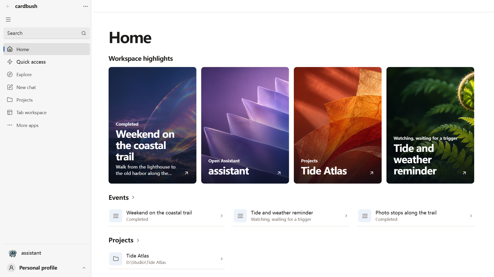
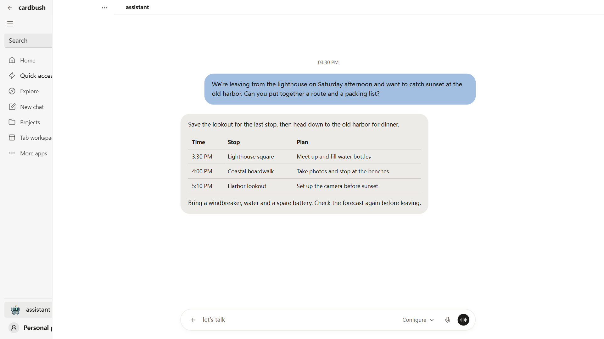
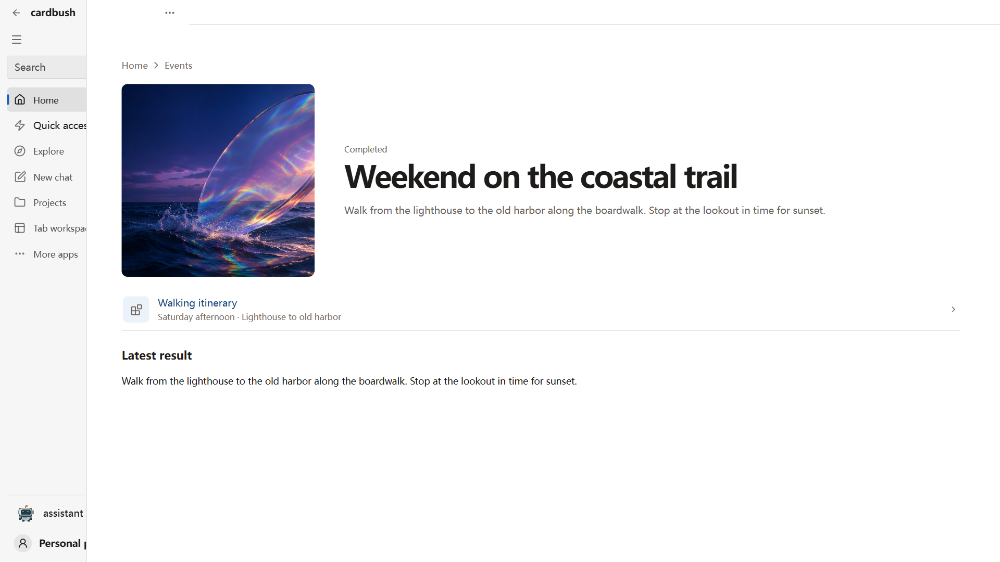
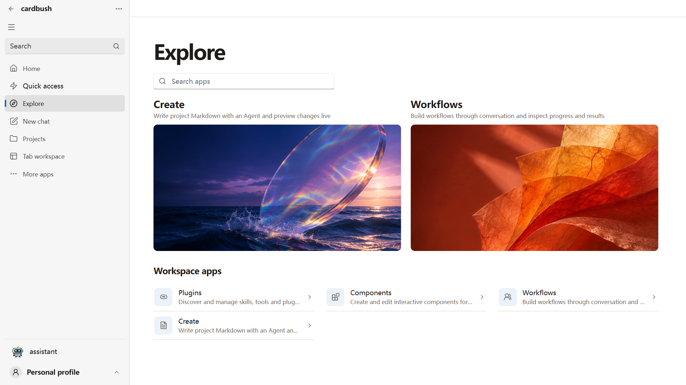
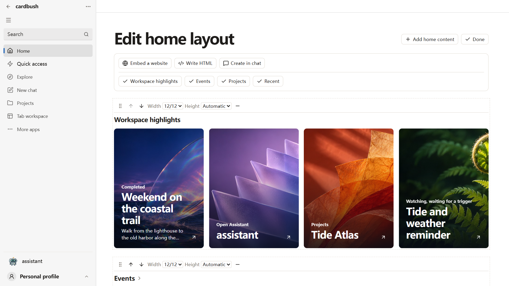

# CardBush

## Short description

Keep projects, files and reminders in one desktop workspace. Pick up where you left off with Assistant by text or voice.

## Description

Open CardBush to see your recent projects, the events you’re following and results that are ready to read. Planning a weekend walk? Ask Assistant to turn a few ideas into an itinerary, register a weather reminder and open the route and packing list from Home.

Arrange Home around the way you work. Open Components from Explore to edit the layout, move events and projects into reach, embed a website or add an interactive HTML component of your own.

When you switch to another app, the floating Assistant stays within reach for text, voice and notifications. Use the system tray to return to Home or close the floating window independently.

AI features require a supported model service that you configure. Your provider may charge for usage. Optional browser features require the extension and explicit pairing with Chrome or Edge. Content needed for a task may be sent to your configured model service.

## Features

- Arrange and resize sections on your Home page.
- Work with Assistant by text or voice in a shared context.
- Register reminders and subscriptions, then open events to read the results.
- Find plugins, skills, components and workspace apps from Explore.

## What's new in 1.0.16

Home supports built-in sections, embedded websites and custom HTML components. Return to a page at your previous reading position. Toggle the floating Assistant from the app or system tray and pick up a draft when you reopen it. Install Python or Node.js on demand for plugins that need them.

## Desktop screenshots

