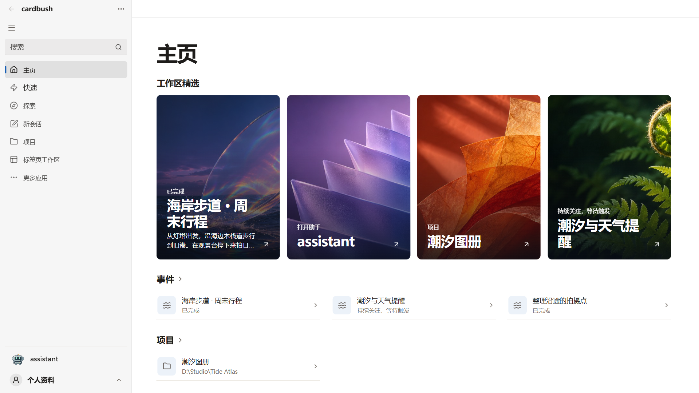
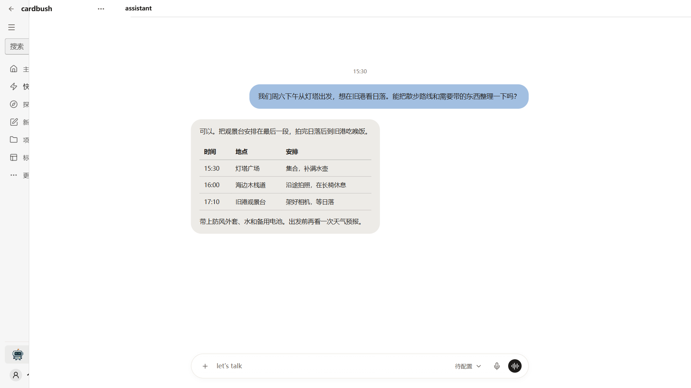
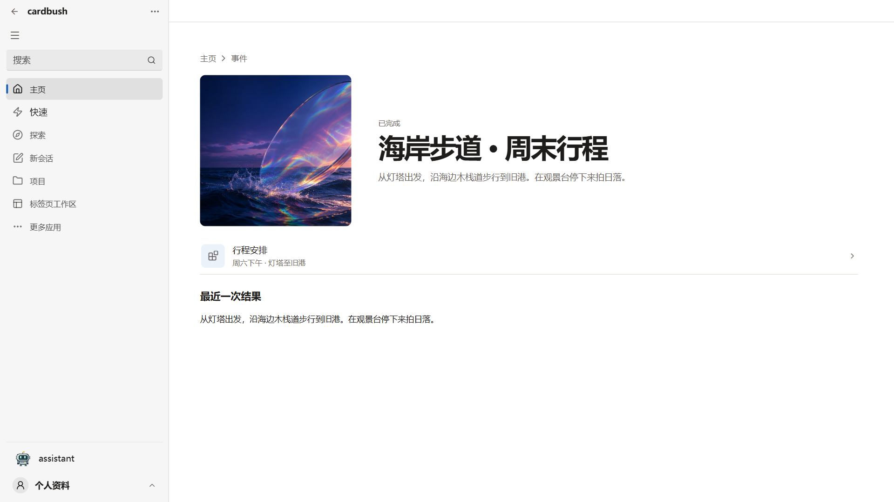
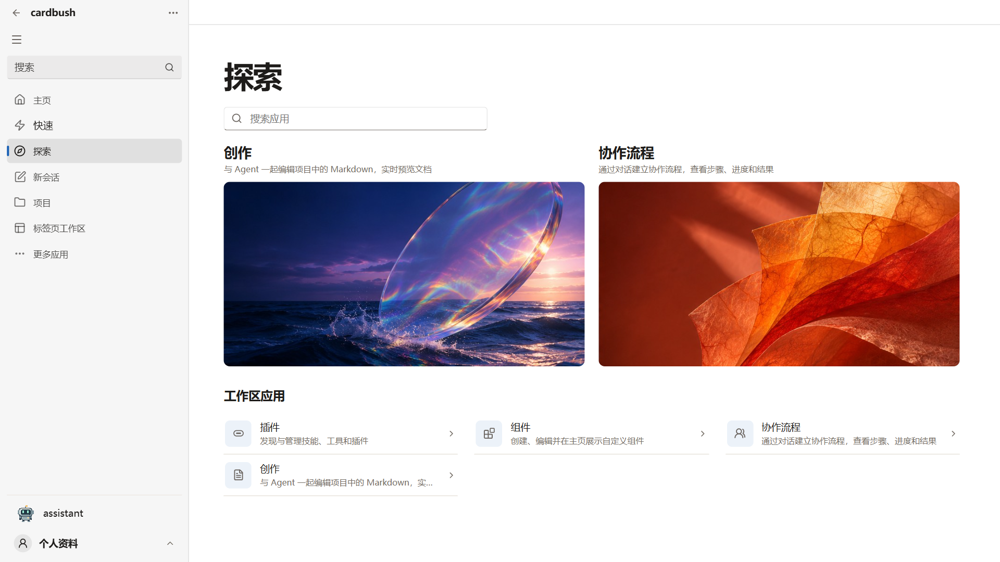
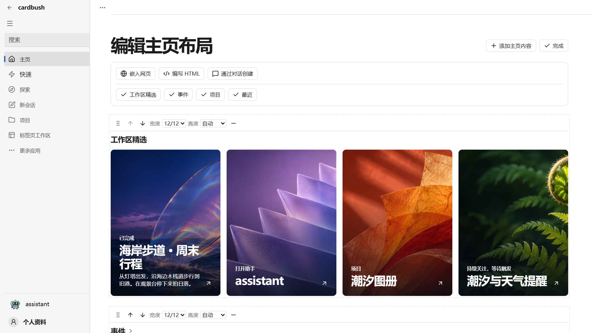

# CardBush

## 简短描述

把项目、文件和提醒放在同一个桌面工作区，用文字或语音与 Assistant 接着做。

## 产品介绍

打开 CardBush，主页会列出最近的项目、持续关注的事件和已完成的结果。准备一次周末出行时，你可以让 Assistant 把想法整理成路线表，把天气提醒登记为事件，再从主页打开行程、查看出发清单。

主页可以随你的工作方式调整。在「探索」中打开「组件」，进入布局编辑，把事件、项目和最近使用的内容放到顺手的位置。你也可以加入网页或自己编写的 HTML 互动组件。

需要切换到其他应用时，可以打开悬浮助手，通过文字、语音或系统通知接着工作。从托盘可以返回主页，也可以单独关闭悬浮窗。

AI 功能需要配置受支持的模型服务，可能产生服务商费用。使用可选的浏览器功能时，需要安装扩展并配对 Chrome 或 Edge。执行任务所需的内容可能发送给你配置的模型服务。

## 功能亮点

- 自定义主页，调整各区块的顺序和大小。
- 通过文字或语音与 Assistant 交流，保留上下文。
- 登记提醒和订阅，从事件详情查看结果。
- 从「探索」打开插件、技能、组件和其他工作区应用。

## 1.0.16 更新内容

主页支持原生区块、嵌入网页和 HTML 组件。返回已访问的页面时可继续从原位置阅读。悬浮助手支持从应用或托盘开关，有草稿时可以关闭并在下次打开后继续输入。需要 Python 或 Node.js 的插件可以使用按需安装的运行环境。

## 桌面截图

